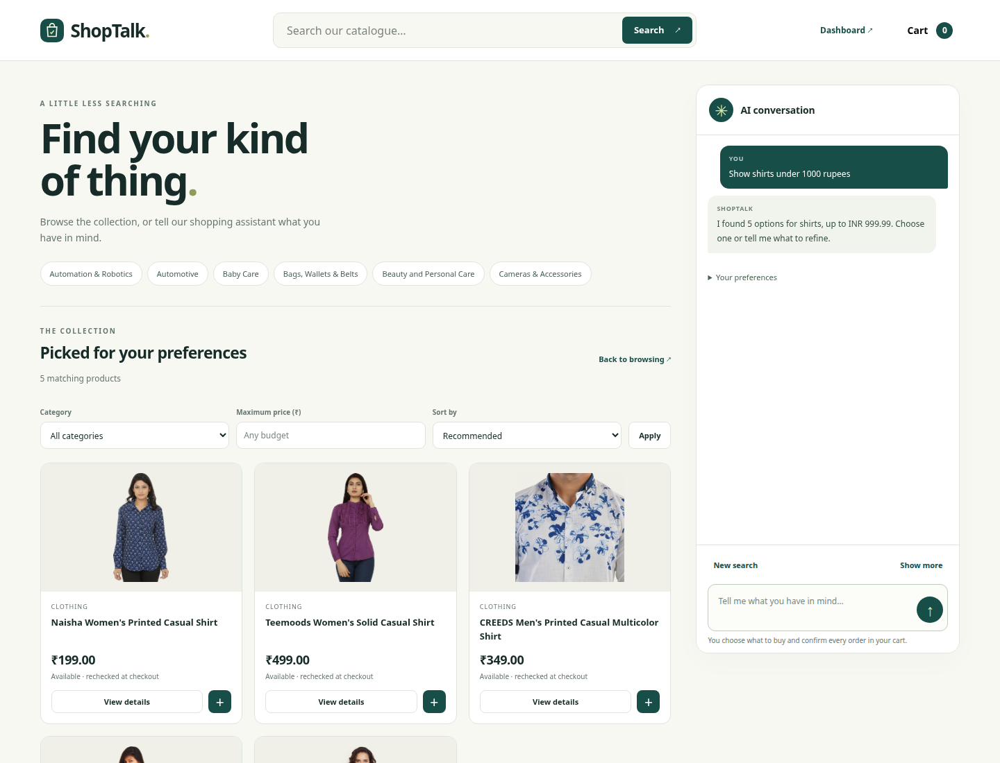
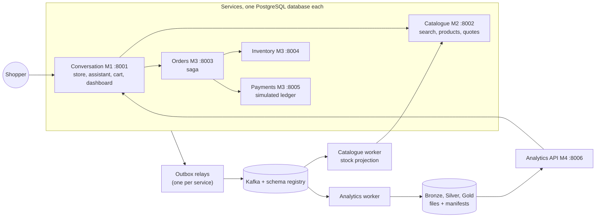
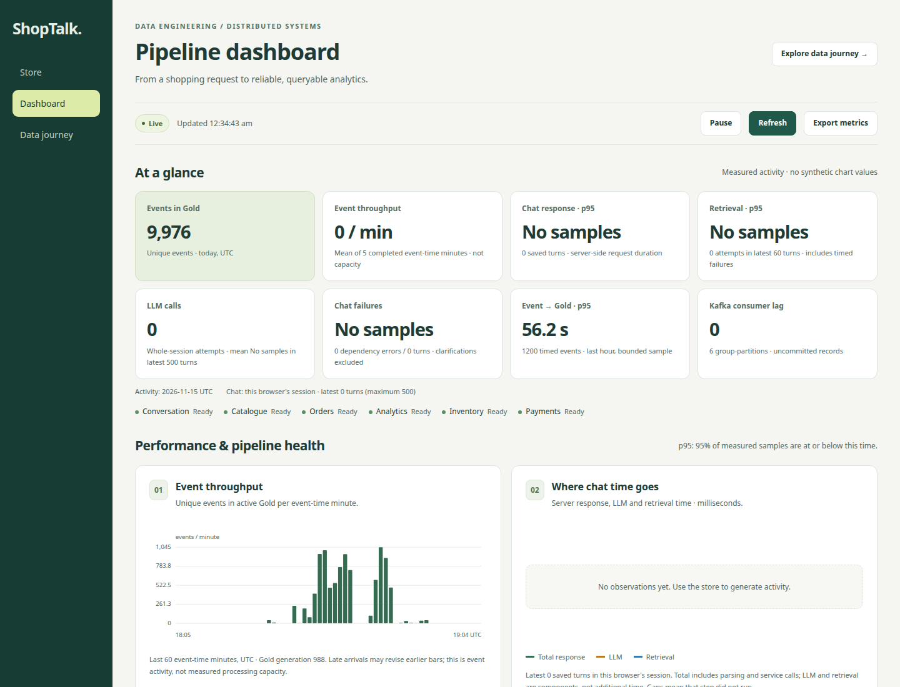
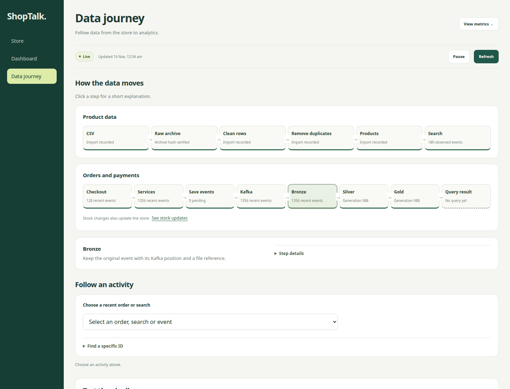

# ShopTalk Data Platform

**An agentic shopping assistant on a distributed, fault-tolerant e-commerce data platform.**

Data Engineering course project (Semester 5), Group 3. Repository:
[github.com/harsh-c-16/shoptalk-data-platform](https://github.com/harsh-c-16/shoptalk-data-platform).
Specification version 2.0 (24 October 2026).



ShopTalk is a working online store built on the real 20,000-row Flipkart product catalogue. A shopper
can browse, search or simply tell the assistant what they want ("shirts under 1000 rupees"), then
add products to a cart, review a quote and confirm a simulated purchase. Behind the store, every
search, cart change, order, stock movement and payment becomes an event. Each service records its
events in its own database together with the business change (a transactional outbox), a relay
sends them to Kafka, and an analytics pipeline turns them into queryable Bronze, Silver and Gold
data. The focus of the project is the data engineering underneath: correct loading, indexing,
idempotent transactions, streaming, deduplication, late events, compaction and recovery from
failures, each measured against a baseline.

## Highlights

- **Real catalogue, loaded reproducibly.** 20,000 source rows become 19,998 canonical listings and
  19,920 active products through deterministic normalization rules, with hash-pinned manifests.
- **Hybrid product search.** Lexical ranking plus semantic vectors (`all-MiniLM-L6-v2` in PostgreSQL
  with pgvector), fused, with hard filters for category, price, brand, colour, size and material.
- **Shopping assistant.** The search box uses a deterministic intent parser with no model call; the
  assistant uses Gemini for free-form conversation, with a model-free fixed mode in the API. Product
  facts always come from catalogue tools, never from the model.
- **Safe checkout.** Quotes, stock reservations, simulated payments and a durable saga with
  compensation. Writes carry idempotency keys, so a retried or double-clicked checkout creates one
  order and one charge (tested with 50 simultaneous copies).
- **Streaming lakehouse.** Transactional outbox in every service, Kafka with a schema registry, then
  Bronze (raw events as JSON lines, with their Kafka position), Silver (validated, deduplicated) and
  Gold (business facts) as Parquet, all published through manifests, with event-time windows,
  late-event reconciliation and replay.
- **Observable and testable.** A live pipeline dashboard, a data-journey view that traces one order
  or search through every stage, and a failure lab that injects real faults and verifies recovery.

## Architecture



Everything runs in 12 Docker containers bound to `127.0.0.1`. Ports, image pins and resource limits
are in [infra/DEPLOYMENT_INFO.md](infra/DEPLOYMENT_INFO.md).

| Pipeline dashboard | Data journey |
|---|---|
|  |  |

## Measured results

All numbers below are owner-run on a single machine; each linked document states its exact setup,
repetitions and limits.

| Area | What was compared | Result | Details |
|---|---|---|---|
| Whole system under load | 1 to 32 concurrent shoppers, full purchase flow | About **2.2-2.7 purchases/s**, **0 failed purchases**; catalogue search p50 **106 ms**; after the load, 818 orders, stock on 288 products and all Gold rows reconcile exactly | [Load, stress and failure tests](docs/harsh/LOAD_AND_STRESS_TEST.md) |
| Failure and recovery | Analytics pause, lost response, payment decline, saga crash, late payment, refund, last-unit race, duplicate delivery | **8 of 8 passed, 97 of 97 independent checks** | [Load, stress and failure tests](docs/harsh/LOAD_AND_STRESS_TEST.md), [failure demos](docs/jaineel/FAILURE_DEMOS_2026_11_14.md) |
| Catalogue import | Row-by-row `INSERT` vs `COPY` | Staging **3.74 → 1.13 s**, whole import **11.81 → 9.26 s**, identical output | [Import comparison](docs/harsh/IMPORT_COMPARISON.md) |
| Search indexing | No index vs category + price B-tree | Lexical search p50 **42.7 → 13.5 ms** (p95 unchanged) | [M2 experiments](docs/harsh/experiments.md) |
| Index type per query | B-tree vs hash vs none, category + price | **1.295 ms** vs 2.610 ms vs 4.160 ms; BRIN wins only on price-sorted data | [Presentation comparison](docs/jaineel/PRESENTATION_COMPARISON.md) |
| Lakehouse layout | Many small Parquet files vs compaction | **11,146 → 91 files**; query 1,023 → 10 ms warm, 1,853 → 19 ms cold, same results | [M2 experiments](docs/harsh/experiments.md) |
| Vector index | Exact search vs HNSW | Not adopted at this size: p95 worse, recall 0.906 | [M2 experiments](docs/harsh/experiments.md) |
| Streaming correctness | Duplicate delivery, out-of-order stock, late event, malformed record | One logical effect per event, newer stock kept, late window corrected, bad record quarantined | [Presentation comparison](docs/jaineel/PRESENTATION_COMPARISON.md) |

Known limits, also measured: PostgreSQL (0.5 CPU in the prototype) is the main bottleneck; under
sustained checkout load an event takes about 35 s (p50) to reach Gold, mostly waiting in the outbox;
the conversation container's 128 MiB memory limit was hit once under a burst. See the
[load test](docs/harsh/LOAD_AND_STRESS_TEST.md#what-limits-capacity).

## Running the prototype

Requirements: Docker, Python 3.11 with [uv](https://docs.astral.sh/uv/) 0.10.x, and the Flipkart CSV
in `data/raw/`. First-time setup (import, seed, projection, retrieval) is in
[infra/PROTOTYPE.md](infra/PROTOTYPE.md).

**Windows (presentation machine)**

```powershell
.\start-prototype.ps1      # starts everything, checks health, then prints the store URL
.\start-failure-demo.ps1   # optional: enables the dashboard's failure lab
.\stop-prototype.ps1       # stops containers, keeps all data
```

**Linux**: the same steps as shell commands are in
[infra/DEPLOYMENT_INFO.md](infra/DEPLOYMENT_INFO.md) (start, verify, demo, stop).

Then open:

| Page | Address |
|---|---|
| Store and assistant | http://127.0.0.1:8001/ |
| Pipeline dashboard | http://127.0.0.1:8001/dashboard |
| Data journey | http://127.0.0.1:8001/journey |

The guided demonstration is in [PRESENTATION_READY.md](docs/jaineel/PRESENTATION_READY.md) and
[PROFESSOR_DEMO.md](docs/jaineel/PROFESSOR_DEMO.md). `python -m projectctl demo-check` checks the
demo searches before presenting. Payments are simulated; no real payment details are ever needed.

## Tests

```bash
uv sync --locked
uv run --locked python -m pytest -q
node --test tests/conversation/storefront.test.cjs
```

Tests that need a real database run when `CATALOG_TEST_DATABASE_URL`, `ANALYTICS_TEST_DATABASE_URL`,
`INVENTORY_TEST_DATABASE_URL` and the other `*_TEST_DATABASE_URL` variables point at a PostgreSQL 18
server with pgvector; otherwise they are skipped. CI ([offline.yml](.github/workflows/offline.yml))
runs the locked install, the API contract checks, the offline verification suite and the storefront
tests on Windows. See
[projectctl/README.md](projectctl/README.md) for the full command surface.

## Team

| Member | Roll number | Module | Brief | Progress |
|---|---|---|---|---|
| **Jaineel Vora** | B24CM1080 | **M1 / M0**: assistant workflow, session and cart state, measurement harness, oracle, dashboards, integration | [04](docs/specs/04_JAINEEL_VORA.md) | [progress](docs/jaineel/progress.md) |
| **Harsh Chaudhari** | B24CM1027 | **M2**: catalogue import and normalization, search and retrieval, stock read model, quotes, compaction and query benchmarks | [05](docs/specs/05_HARSH_CHAUDHARI.md) | [progress](docs/harsh/progress.md) |
| **Aditya Gaurav** | B24CM1003 | **M3**: orders, inventory, simulated payments, durable saga, shared outbox library | [06](docs/specs/06_ADITYA_GAURAV.md) | [progress](docs/aditya/progress.md) |
| **Vichitr Arora** | B24CM1067 | **M4**: Kafka, schema registry, Bronze/Silver/Gold pipelines, manifests, replay | [07](docs/specs/07_VICHITR_ARORA.md) | [progress](docs/vichitr/progress.md) |

## Documentation

Specifications in [`docs/specs/`](docs/specs/):

- [00_README.md](docs/specs/00_README.md): navigation and document index.
- [01_PROJECT_CONTEXT.md](docs/specs/01_PROJECT_CONTEXT.md): architecture decisions, scope and technology stack.
- [02_COMMON_SPEC.md](docs/specs/02_COMMON_SPEC.md): interface contracts, shared data types and error codes.
- [03_EVALUATION_SPEC.md](docs/specs/03_EVALUATION_SPEC.md): workloads, metric definitions and correctness gates.
- [04](docs/specs/04_JAINEEL_VORA.md) to [07](docs/specs/07_VICHITR_ARORA.md): each member's brief.
- [08_DATASET_PROFILE_AND_RULES.md](docs/specs/08_DATASET_PROFILE_AND_RULES.md): Flipkart CSV profile and normalization rules.
- [09_EVALUATION_RUNBOOK.md](docs/specs/09_EVALUATION_RUNBOOK.md): command surface, runbook and verification commands.
- [10_JAINEEL_CODEX_PLAYBOOK.md](docs/specs/10_JAINEEL_CODEX_PLAYBOOK.md): phased implementation playbook.
- [11_SHOPPING_EXPERIENCE.md](docs/specs/11_SHOPPING_EXPERIENCE.md): store and assistant behaviour.

Useful entry points: [deployment and ports](infra/DEPLOYMENT_INFO.md),
[catalogue data sheet](docs/harsh/DATA_SHEET.md), [demo searches](docs/harsh/DEMO_SEARCHES.md),
[dashboard](docs/jaineel/DASHBOARD_2026_11_14.md),
[Windows measurements](docs/jaineel/WINDOWS_MEASUREMENTS.md),
[professor questions and results](docs/jaineel/PROFESSOR_QUESTIONS_AND_RESULTS.md),
[ownership matrix](docs/OWNERSHIP.md) and [rules for contributors and coding agents](AGENTS.md).

## Repository layout

```
├── services/
│   ├── conversation/   M1: store, assistant, cart, checkout, dashboard (web/ holds the UI)
│   ├── catalog/        M2: catalogue, search, quotes
│   ├── orders/         M3: orders and saga
│   ├── inventory/      M3: stock reservations
│   └── payments/       M3: simulated payments ledger
├── pipelines/
│   ├── catalog/        M2: CSV import and normalization
│   ├── ingestion/      M4: Kafka consumer, Bronze landing
│   ├── curation/       M4: Silver
│   ├── gold/           M4: Gold facts and publication
│   ├── replay/         M4: replay and recovery
│   └── storage/        M4: Parquet files and manifests
├── analytics/          M2: compaction and analytical queries
├── shared/             contracts, outbox (M3), event transport (M4), telemetry (M0)
├── contracts/          OpenAPI, event schemas, dictionaries, fixtures
├── migrations/         one folder per service database
├── infra/              Docker Compose, deployment, image pins
├── benchmarks/         M0: workloads, runners, failure demo, data journey
├── projectctl/         M0: team command-line tool
├── tests/              unit, contract, live-database and integration tests
├── docs/               specifications, per-member notes, images
├── data/raw/           Flipkart CSV (not committed)
└── *.ps1               Windows start, stop and measurement scripts
```

Work happens in per-member branches merged to `main` through pull requests; ownership of every
path is in [docs/OWNERSHIP.md](docs/OWNERSHIP.md).
