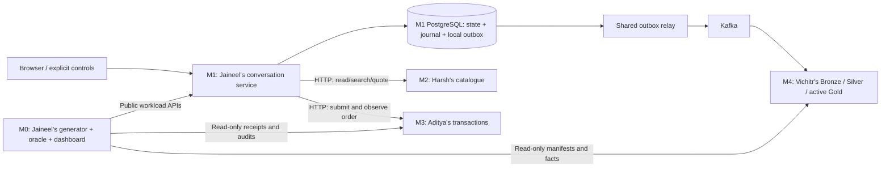

# Jaineel's presentation and viva guide

Prepared 15 November 2026 for the 16 November presentation. Scope: **M1 + M0**, as assigned in [ownership](../OWNERSHIP.md) and [your brief](../specs/04_JAINEEL_VORA.md). This is a personal explanation of the existing implementation, not a replacement specification.

Read the opening, schema answer, measured comparison and edge-case answers first. The rest is backup for questions.

**Evidence labels:** implemented = present in code; freshly tested = executed for this preparation; retained real run = previously executed against real services and now checked from saved evidence; measured component = isolated local experiment; considered = design alternative without a head-to-head implementation benchmark. These labels are deliberately different.

## 1. Your opening: about 45 seconds

> “My part has two responsibilities. M1 provides durable sessions, carts and a controlled shopping workflow. It integrates the catalogue and transaction services through their APIs, preserves request identity across retries, and requires confirmation against the exact quote and cart version.
>
> M0 makes the project measurable. I implemented the workload generator, independent reconciliation, experiment comparison and monitoring. I check whether accepted work produces the correct stock, payment and analytical effects, and whether reported latency includes the right stages and unfinished work. My data engineering contribution is reproducibility, data quality, lineage and trustworthy evaluation—not just the chat interface.”

When discussing team mechanisms, say **“I integrate and verify it”** where that is your role:

| Your implementation | Provider implementation you consume |
|---|---|
| Session/cart state, confirmation, command journal, dialogue, UI | Harsh: catalogue normalization, search/ranking, prices, quotes |
| Workload generation, fault/demo orchestration, measurement, independent oracle | Aditya: reservation, order saga, simulated payments, generic outbox |
| Dashboard, comparison/reporting, evidence validation | Vichitr: event codec/transport, Kafka, Bronze/Silver/Gold, manifests, replay |

## 2. Draw this architecture



> “The request path changes operational state. The event path carries committed facts into analytics. My measurement path observes both. An HTTP response, a Kafka acknowledgement and a queryable Gold fact are three different milestones.”

The prototype runs separate service processes/containers on one host. Databases are service-owned but share one PostgreSQL instance. This establishes service boundaries and process-recovery examples, not independent-host availability or broker replication.

### Architecture choices and alternatives

| Decision | Why it fits your part | Alternative and trade-off | What was actually tried? |
|---|---|---|---|
| Service-owned PostgreSQL; HTTP/events between owners | Local constraints/transactions and explicit contracts; each owner has one write authority | A monolith/shared database simplifies joins and deployment but couples writes and responsibilities | Current service architecture implemented; no monolith performance comparison |
| Durable session/cart storage | Reload/restart can recover state and prior mutation results | Process memory loses state on restart; a cache adds another durability/invalidation design | PostgreSQL persistence/reconnection tested; no Redis-versus-PostgreSQL benchmark |
| Command journal before remote mutation | A timeout can be recovered using the exact original provider request/key | Blind retry with a new key can create another logical purchase | Response-loss/restart and concurrency tests; retained real retry demonstration |
| Local state + outbox in one transaction | Committed state has durable publication work; a relay retries later | Separate DB commit and Kafka send can leave a dual-write gap | Shared implementation integrated; rollback tests; relay/recovery evidence has its own scope |
| Explicit checkout and asynchronous order finality | Confirmation is tied to price/cart facts; 202 means accepted and the UI observes completion | Model-selected purchases or interpreting timeout as failure create unsafe ambiguity | Explicit controls, confirmation checks and pending/recovery cases tested |
| Independent oracle | Detects errors even when components agree on the same wrong number | Reusing the production reducer as the checker can repeat its mistake | Corrupted totals, duplicate debit, missing evidence and invalid stock fixtures tested |
| Open-loop workload scheduler | Intended arrivals continue independently of response time, exposing saturation | A closed loop slows the offered load when responses slow, hiding queueing | Slow publisher, queue bounds, cutoff/drain and unresolved-ack tests |
| Raw observations plus dashboard | Exact results can be rebuilt without the dashboard | Screenshots or averages alone cannot reconstruct cohorts, failures or quantiles | Metric arithmetic and observation tests; raw artifacts retained |

The command journal and outbox have different jobs: **the journal remembers what M1 asked another service to do; the outbox remembers facts M1 must publish.** Neither is a second implementation of the Orders saga.

## 3. “Why did you use a star schema instead of another schema?”

Use this answer first:

> “For my operational M1 service, I did not use a star schema. I use relational tables for sessions, carts, lines and operation identities, with JSONB snapshots for variable response/context payloads. My workload is small transactional updates and exact retry recovery. The analytical side exposes facts and aggregates at declared grains; calling those tables a complete star schema would require actual dimension tables and relationships.”

A star schema normally has fact tables linked to dimensions. Having a table named `order_fact`, or having Bronze/Silver/Gold layers, does not by itself establish one. [Kimball's definition](https://www.kimballgroup.com/data-warehouse-business-intelligence-resources/kimball-techniques/dimensional-modeling-techniques/star-schema-olap-cube/).

### Your actual schema: explain the grain before the columns

| Table | One row represents | Key/design reason |
|---|---|---|
| `sessions` | One session in a namespace | `(namespace, session_id)`; owner identity, event version and private JSONB shopping context |
| `carts` | One cart for a session | `(namespace, cart_id)`; unique session binding, version and current quote/confirmation binding |
| `cart_items` | One SKU line within a cart | `(namespace, cart_id, sku)` prevents duplicate lines; quantity and display-price constraints |
| `turns` | One persisted request outcome | `(namespace, request_id)`; unique turn ID, request hash, response and private diagnostics |
| `operation_keys` | One idempotent operation for one principal | `(namespace, user_id, operation, key)` prevents keys from colliding across users/actions |
| `confirmations` | One confirmation's binding | Records cart, quote and cart version so a confirmation cannot authorize another quote |
| `workflow_commands` | One journalled provider operation under an M1 key | Durable provider body/context/key; pending, complete or rejected state |
| `intent_attempts` | One reserved optional intent attempt | Survives a later response rollback, preventing a retry from making another model attempt |

The local outbox/diagnostic tables come from the shared implementations. Do not present them as a separate queue implementation you invented.

Concrete example: one cart with three products is **one cart row and three line rows**. Updating one quantity increments the cart version and invalidates its old quote/confirmation. A database constraint prevents storing quantity 11; quantity 0 is handled as deletion of the line, so stored quantities remain 1–10. There are at most 20 distinct lines by service validation.

**Why relations plus JSONB?** Put identities, quantities, versions and relationships in constrained columns; store changing response/provider/context structures as JSONB. A cached response snapshot is intentional duplication: it returns the original operation result on replay. Do not claim this is a fully normalized mathematical model or that JSONB avoids schema validation. JSONB validates JSON representation, while typed contracts validate business shape. PostgreSQL also does not retain original JSON whitespace, key order or duplicate keys in JSONB, so it is not a substitute for a byte-preserving source archive. [PostgreSQL JSON documentation](https://www.postgresql.org/docs/18/datatype-json.html).

### Schema alternatives: considered, not secretly benchmarked

| Option | Where it could fit | Why it was not chosen for M1's authoritative state |
|---|---|---|
| One wide table | Simple read/export view | Repeats session/cart facts per line or turn; updates and uniqueness become harder to reason about |
| One JSON document per cart/session | Convenient nested API payload | Would move more identity, line-level constraints and concurrency rules into application logic; no document-database comparison was run |
| EAV (entity/attribute/value) | Highly variable metadata | Core quantities, IDs and versions are known fields; generic attributes obscure their types and constraints |
| Star | BI facts analysed by product/date/category dimensions | It answers analytical questions rather than mutable cart-command recovery |
| Snowflake | Normalized dimensional hierarchies | More joins and dimension maintenance; no demonstrated requirement in your session/cart path |
| Full event-sourced M1 | Rebuild operational state from an authoritative event log | Requires replay/version/migration rules for all commands; current M1 stores state plus journals/outbox, so do not call it full event sourcing |

If asked to design a future star: declare a **line-level** sales fact `(order_id, line_number)` with quantity and immutable line amounts, then reviewed date/product dimensions. Do not join an order-level total to every product line and sum it: a three-line order would be counted three times. Versioned product dimensions/SCD Type 2 could answer “what category did this product have then?”, but this is a future design, not an implemented M1 feature or measured comparison.

## 4. Your strongest data engineering explanation

> “I measure conservation of records and business effects across different grains. Kafka delivery count is not unique event count; a payment attempt is not a confirmed sale; and a staged row is not yet an active analytical result.”

| DE concept | Your concrete responsibility | Example to give |
|---|---|---|
| Data provenance | Preserve dataset, fixture, code/config and artifact identity | A source SHA change invalidates an otherwise identical-looking benchmark comparison |
| Data quality | Independent expectations, explicit nulls, schema checks and rejection evidence | Missing price/size cannot become a fabricated purchasable value |
| Reproducible ingestion workloads | Seeded logical scenarios and exact emitted journals | Same logical inputs across repetitions, fresh namespaces/IDs to avoid state contamination |
| Delivery versus logical identity | Match acknowledgements and receipts to exact IDs/coordinates | Three deliveries can correctly represent two unique valid events |
| OLTP/OLAP separation | Submit commands through APIs; observe active analytical outputs | A checkout can finish while analytics is paused; the dashboard shows pending publication |
| Event time versus processing time | Use the proper clock for each question | Event time assigns a late fact to its original minute; ingress-to-correction measures repair delay |
| Aggregation semantics | Verify grain, counts, sums and unresolved states | Conversion is confirmed orders divided by created orders, not site visitors |
| Observability | Track each backlog boundary independently | Kafka lag can be zero while Gold export is pending |
| Independent reconciliation | Compare expected IDs and owner audit facts without corrective writes | A matching total is insufficient if one debit is missing and another duplicated |
| Experimental design | Reject mismatched controls; retain every repetition and failed trial | A missing resource collector prevents a qualified speedup claim |

The original catalogue has **20,000 observations → 19,998 canonical listings → 19,920 active listings**, with 78 inactive missing-price rows and 2 superseded observations. These are historical source-profile counts, not transaction volume or throughput. Stock, customers, traffic and payments are separately simulated. Harsh owns the transformation; you own independent checks and reproducible consumption.

## 5. “Retain summaries rather than delete old entries?”

> “I would retain summaries for repeated aggregate questions, while retaining the detail needed for our audit and replay period. A summary can preserve selected sums and counts, but it cannot prove which event contributed or reconstruct a future query. Our experiment showed a large representation-size reduction but no query-speed win.”

**Measured local DuckDB policy experiment, 14 November; revalidated 15 November:**

| Measure | Raw events | Minute/type summaries |
|---|---:|---:|
| Rows | 20,000 | 1,336 |
| Zstandard Parquet bytes | 93,828 | 3,009 |
| Aggregate query median, ms | 2.585 | 2.805 |

Summary-only representation was **96.79% smaller**, but its query was **8.51% slower** in this small warm experiment. Building the rollup took **34.701 ms**. Keeping both representations uses **96,837 bytes**, before metadata; that is not a 96.79% saving of total platform storage.

What worked: independent counts and integer monetary sums matched in every trial. What did not: this fixture did not establish faster analytical queries. Fixed query/file overhead is a possible explanation at this scale, not a separately measured cause.

Two histories `(E1=100, E2=200)` and `(E1=200, E2=100)` both have count 2 and sum 300. The summary cannot identify the wrong event amount. In the separate replay policy probe, retaining the seen-ID gave **1 effect**; deleting it before replay gave **2 effects**. That unsafe deletion is an experimental counterexample, not current production behavior.

Useful distinctions:

- **Compaction** rewrites the same logical rows into fewer/larger files.
- **Aggregation** changes the grain and loses detail.
- **Retention** decides how long each data class and identity record remains available.
- **Archival** moves detail to another storage tier while preserving recoverability; a future tiering proposal here, not a deployed object store.

The canonical policy is Kafka/published outbox 7 days; Bronze, dedup keys, manifests and evidence at least 30 days and until evaluation acceptance, whichever is later. Active replay references block deletion; unpublished outbox rows cannot be purged. Cleanup is explicit and disabled during experiments. Do not claim an automatic summary-only TTL was deployed. [Common retention contract](../specs/02_COMMON_SPEC.md#12-quarantine-replay-retention-and-provenance).

For your metrics, retain `sum` and `count` for mergeable means. Do not average bucket means without their counts; do not average minute p95s into a global p95. Exact quantiles require raw durations, or a separately described histogram approximation.

## 6. “Other than B-trees, what did you try? Any bottlenecks?”

Start with the ownership distinction:

> “My M1 identity and pending-command lookups use the existing relational keys/indexes. I also ran an isolated comparison of B-tree, hash, BRIN and GIN for the evaluation work. That comparison used a catalogue projection; Harsh owns the production catalogue indexes. I did not replace its production index based on these timings.”

M1 has composite primary/unique keys and a partial `workflow_pending_cart` index on `(namespace, cart_id)` where the operation is pending checkout. It supports the check that prevents editing a cart during uncertain checkout. The broader catalogue timings below are **not a benchmark of that M1 index**.

| Predicate/layout | No optional index | B-tree | Hash | BRIN | GIN |
|---|---:|---:|---:|---:|---:|
| Category + price, shuffled | 4.160 | **1.295** | 2.610 | 4.069 | 3.215 |
| Rare category equality, shuffled | 2.650 | 1.071 | **1.028** | 1.374 | 3.211 |
| Price range, shuffled | 2.733 | **1.426** | 2.771 | 2.472 | 2.680 |
| Keyword `shirt`, shuffled | 4.756 | 5.108 | 5.171 | 5.386 | **3.303** |
| Price range, price-sorted | 2.536 | 1.387 | — | **0.748** | — |

Units: **client query milliseconds**, lower is better. Cells are median of three repetition medians, ten timed calls per repetition and three warmups. “No optional index” retains the primary key. Dashes mean omitted from this table, not zero time. Close point estimates such as rare-category hash/B-tree do not establish a statistically significant winner.

Mechanisms: B-tree supports equality/range/order; hash serves equality; GIN indexes component membership such as text terms; BRIN summarizes physical block ranges and benefits from correlated layout. None automatically serves every predicate. GiST, SP-GiST, bloom, tries, LSM-based engines and caches were **not benchmarked in this experiment**. [PostgreSQL index capabilities](https://www.postgresql.org/docs/18/indexes-types.html).

Interpretation you can defend:

- B-tree category/price time was **68.86% lower** than the no-optional-index comparator here.
- GIN helped the positive-hit `shirt` query, with **30.55% lower** time; this is a text-search extension, separate from frozen B0/O2.
- BRIN was less effective on shuffled data and became competitive on the sorted layout. Sorting/rewrite cost is excluded.
- Index bytes/build milliseconds: B-tree **424 KiB / 25.502 ms**; hash **840 / 20.599**; BRIN **24 / 5.917**; GIN **1,184 / 45.609**. Faster reads are not free storage/build work.
- Plans and equal result digests were checked. The planner was free to use a sequential scan; creating an index does not prove it was used.

Scope: original active catalogue projected to title/category/price; PostgreSQL limited to 1 CPU and 512 MiB with a 256 MiB RAM-backed data directory; warm reads. These exclude HTTP, stock joins, embeddings, Kafka and Gold. The price-only update probe does not establish GIN text-update overhead. This is component evidence, not an application-capacity or SSD claim. Full plans, costs, repetitions and limitations: [existing measured report](PROFESSOR_QUESTIONS_AND_RESULTS.md).

## 7. Your M1 edge cases: problem → handling → evidence

| Professor's scenario | Your handling | Evidence to point at |
|---|---|---|
| User double-clicks or retries a cart update | Scoped key + request hash; replay original outcome; one logical effect | `test_state`: replay/concurrent mutation tests |
| Same key, changed quantity/body | Reject conflicting business input; do not reinterpret the key as a new operation | `test_changed_business_input_conflicts_with_same_key` |
| Two browser tabs edit cart version 3 | Serialize state access and require expected version; after one succeeds, the other is stale | Concurrent cart and stale-version tests |
| User changes cart after seeing a quote | Increment version and clear quote/confirmation; require a new quote | `test_edit_invalidates_quote_and_confirmation` |
| Cart changes while quote HTTP call is running | Recheck version when binding the returned quote | `test_quote_race_cart_edit_during_provider_call_is_rejected` |
| Quote expires before first checkout | Reject initial purchase submission; request/review a fresh quote | `test_quote_expired_before_first_checkout_is_rejected` |
| Checkout accepted but HTTP response disappears | Journal existed before the call; recover the same provider key/body; observe same order | `test_lost_checkout_response_survives_restart_and_expiry_with_same_order`; retained real retry run |
| Retry arrives under another transport key | Same quote maps to same downstream identity; durable accepted response is reused | New-key replay, inflight alias and concurrent checkout tests |
| Orders is unavailable | Keep outcome pending/unknown; block cart edits/new quotes during uncertainty | `test_orders_unavailable_remains_unknown_and_recovers_same_command` |
| Database/outbox append fails | Roll back the local state/event transaction; retain an already-saved remote command for recovery | State rollback and real shared-outbox integration tests |
| Model invents price, stock, SKU, filter or checkout action | Validate typed plan/provider facts; retain explicit constraints; purchases use controls and authoritative quote | Assist, shopping-model and hard-filter tests |
| Unknown attribute or unsupported negation | Clarify rather than silently dropping a hard constraint; known unavailable facet can return no results | Intent/search regression tests |
| Model timeout/malformed reply | Bounded single attempt, visible failure/clarification; original optional fallback has durable attempt reservation | Assist timeout, replay and rollback-attempt tests |
| User resets search but old preferences remain | Reset shopping memory before planning; preserve session/cart and operation evidence | Recorded reset fix; dialogue regressions and retained browser evidence |
| Another user's/session's IDs are supplied | Check namespace/principal/session ownership before provider calls | State/workflow isolation tests; this is not a claim of production customer authentication |

Concurrency detail worth explaining: M1 combines expected cart versions with database row/advisory locks. It is not “only optimistic locking.” The version expresses which state the user confirmed; the lock protects the database transition. Operations on the same session intentionally serialize, which can become contention. No per-session saturation number has been established here.

## 8. Edge cases you verify across teammates' services

> “I supply scenarios and independently check the effects. The provider owner implements the reservation, stream reducer or replay mechanism.”

These seven **retained real Kafka/owner-service/active-Gold scenarios** were revalidated for this preparation; they were not rerun as seven fresh live trials:

| Case | Observed result | Your DE check |
|---|---|---|
| Duplicate delivery | 3 deliveries, 2 valid logical IDs, 1 duplicate | Preserve source-delivery accounting and one contribution per ID |
| Same event ID, different content | `EVENT_ID_CONFLICT` | Do not silently accept an identity collision as a retry |
| Malformed message | 1 bad JSON quarantined; 2 valid neighbors reach Gold | Invalid data is isolated, accounted for and recoverable |
| Out-of-order stock | v2/4 units followed by v1/9 still shows v2/4 | Event arrival order cannot replace newer state |
| Late event | Earlier window count revised 1 → 2 in a newer generation | Event-time correctness and correction visibility |
| Replay twice | Business equality and no second logical effect | Rebuild analytics in isolation; do not repeat operational purchases |
| Last unit race | 2 checkouts, 1 confirmed, 1 cancelled, 1 matching debit | Exact order/ledger/stock conservation and Gold state |

The two-buyer demonstration is not the full required 100-buyer concurrency campaign. A demonstration pass is not a stress-capacity measurement.

Retained controller runs also cover response loss, worker crash, decline, analytics pause/catch-up and a 35-second late-payment case. **Late payment cancellation before debit is not a refund demonstration.** The separately attempted fresh refund rehearsal did not reach checkout because catalogue preparation returned 503; its status remains NOT_RUN. A refund claim needs a real debit plus exactly one matching reversal, cancelled order, restored stock and matching Gold.

## 9. “How do I trust your benchmark?”

Explain the method in this order:

1. **Freeze inputs and environment:** code/lock/image/config hashes, original source revision, dictionaries, fixture seed, workload, resources and cache policy.
2. **Change one factor:** e.g. batch size or one index; preserve validation, uniqueness, results and durability. B0 is already correct.
3. **Generate arrivals independently:** record intended schedule, actual send and acknowledgement. Bound pending count and bytes; expose missed arrivals and backpressure.
4. **Measure declared boundaries:** search HTTP, provider query, acceptance, order finality and active Gold are separate metrics.
5. **Keep every outcome:** rejected, unknown and unfinished work remain in denominators; missing timing is null, not zero.
6. **Drain, reconcile and compare:** formal sustained protocol is 60 s warmup + 600 s measurement + up to 120 s drain, three paired randomized repetitions. Finite import and local component probes have their own declared protocols.

Important equations for the viva:

```text
scheduled latency = Gold visible time - intended scheduled time
event-to-Gold latency = Gold visible time - event produced time
Kafka lag = sum(log-end next offset - committed next offset)
latency reduction % = 100 * (baseline - candidate) / baseline
nearest-rank p95 = sorted durations[ceil(0.95 * sample_count) - 1]
```

Local elapsed durations use a monotonic clock. Wire/event timestamps use UTC. Cross-process wall-clock subtraction requires clock qualification/error bounds. Do not subtract monotonic readings from different processes/machines as if they share an origin.

Offered rate, admitted rate and completed useful work are separate. For the formal Gold goodput definition, use the unique valid measured cohort visible within the measurement window divided by window duration; report post-cutoff/drain completions separately. Verify exact IDs as well as totals.

**Example, illustrative rather than a project result:** 100 scheduled requests with only 80 completed means p95 of those 80 does not describe the full 100-request cohort. Say “80 completed, 20 unresolved, completed-only p95 …”. Do not advertise an unconditional p99 when over 1% of the cohort remains unresolved.

**Why independent?** The oracle uses expected fixtures and read-only evidence projections, not production reducers/normalizers. It deliberately rejects wrong money, duplicate debit, missing IDs and stale Gold. The catalogue index probe, separately, reused production normalization to make equal comparison inputs; do not call that step an independent normalization proof.

## 10. What worked, what failed, and what remains unproved

| Item | Honest result | What you learned |
|---|---|---|
| Durable identity/version/confirmation | Implemented and covered by focused storage/workflow tests | Correct retries need persisted identity and state checks, not just a retry loop |
| Same-session dialogue reset | Earlier reset cleared filters after planning but left old model context; fixed before planning | Context reset must cover stored history/products/preferences, not just visible UI text |
| “Black color only” refinement | Earlier grammar mishandled colour/color cue order and emphasis tokens; targeted parsing fixes retained unknown/negation checks | Useful deterministic rules need explicit edge fixtures; do not remove validation to accept more language |
| Dashboard latency interpretation | Older panel mixed prior-day seed events into current traffic; now fixed last-hour event-created cohort with pending counts | Cohort/time boundaries change metric meaning; do not filter only slow/failed outcomes away |
| Summaries | Much smaller representation, slightly slower measured query | Storage savings do not establish latency savings |
| Indexes | Different predicates/layouts preferred different candidates | A method is conditional on workload; the lowest point estimate is not a universal winner |
| Broad Windows optimization run | 276 saved observations, but resource collector failure left run FAILED/NOT QUALIFIED | Preserve useful diagnostics while rejecting an incomplete performance claim |
| Fresh real refund rehearsal | NOT_RUN after catalogue 503 during preparation | No purchase took place; expiry-before-debit is not substitute evidence |
| Full B0/C-BEST, scaling, saturation | Not qualified by this preparation | Implemented harness and a local demo do not establish target throughput or full release acceptance |

Candidate bottlenecks to investigate, **not measured saturation findings**: same-session lock duration, bounded DB connections, catalogue/LLM latency, shared-host resource contention, outbox backlog, Kafka consumer lag and pending Gold export. Use stage timings/queues/plans to locate the bottleneck before changing concurrency or indexes.

## 11. Fixed assistant versus the current Gemini storefront

Do not say “the whole website always uses zero model calls.” There are distinct paths:

| Path | Policy | Why it exists |
|---|---|---|
| Original fixed evaluation endpoint | 0 generative calls; deterministic parsing/templates; one search; 3-second turn budget | Repeatable DE baseline without model variance |
| Original optional assist | At most 1 structured fallback call only when eligible/enabled; 1.5-second model timeout within 3 seconds total | Bounded ambiguity handling; failures do not trigger repair calls |
| Current desktop Gemini shopping dialogue | One model attempt per conversation turn; validated read-only decision; at most 6 catalogue reads including metadata; 18-second provider/25-second total budgets | Separately authorized conversational prototype |
| Explicit cart/quote/checkout controls | No model purchase decision | User confirms exact authoritative quote/cart version |

The desktop also has Basic chat with zero generative calls. The extension is documented in [shopping specification](../specs/11_SHOPPING_EXPERIENCE.md); it does not change the fixed benchmark configuration. No measured model-quality advantage is established by API-spy unit tests.

## 12. Source identity and reproduction caveat

The verified 14 November experiment used original CSV SHA-256:

`56f8f699c9e847356666c2eab3c3ab1244340f6a98ad08e39ea2199ebe993ad1`

The working CSV was explicitly edited on 15 November (one requested product-colour field). Its verified current SHA-256 is:

`ee268fd4222dd68ea8429016b3ee044418aecffc89551a1409a2c4da063df466`

The progress record retains the original snapshot and change receipt under `artifacts/catalogue-edits/20261115T143323Z`. The prior task did not reimport the working CSV or rewrite benchmark manifests. **Equal row counts do not make these the same dataset revision.** Restore/select the original snapshot in an isolated experiment to reproduce the old run, or coordinate a new source revision with Harsh and rerun affected checks. Do not change the frozen expected checksum just to get a green test.

This makes a useful provenance answer: “We preserve which source bytes produced each result; edits do not retroactively alter old evidence.”

## 13. Presentation evidence and reading order

Fresh verification bundle: `artifacts/presentation/20261115-jaineel/`. It verifies **190 saved measurement-file hashes**, **60 index comparator groups / 1,800 timed samples**, and **7 retained real edge-case records**, using existing report validation. Fresh focused correctness: **649 passed, 0 failed, 0 errors, 0 skipped**, in **92.12 seconds**. These are test results, not an application performance measurement. Results are recorded in `correctness.xml`, `pytest.log` and `evidence-verification.json`.

The first suite attempt had 648 passes and one concurrent-retry failure: tests used the default ten-connection API budget while the live demo also used the same role, whose total limit is ten. The final runner used the actual deployed **three-connection** API budget, including the reserved intent-audit slot, and the complete same suite passed. No application logic or assertion was changed. The initial failed evidence is retained separately. This demonstrates why test resource configuration matters; it is not a measured production capacity limit. The final run has one existing Starlette/httpx deprecation warning.

The fresh PostgreSQL tests use only generated `p6_test_*` schemas in M1's database. External catalogue, Orders, model and transport dependencies are explicit doubles as appropriate; shared-event tests exercise real shared codec/outbox/diagnostic code with doubled registry IDs. This is not a fresh full-service integration or throughput campaign. No new live checkout, model call or fault demonstration was submitted for this preparation.

Read/keep open:

1. [Speaking notes](PERSONAL_SPEAKING_NOTES_2026_11_16.md) — short rehearsal sequence.
2. [Measured comparisons](PRESENTATION_COMPARISON.md) — compact tables for slides.
3. [Full measured report](PROFESSOR_QUESTIONS_AND_RESULTS.md) — retained controls, plans, costs and failures.
4. [Actual migrations](../../migrations/conversation/001_state.sql), [workflow journal](../../migrations/conversation/002_workflow.sql), [workflow implementation](../../services/conversation/workflow.py) — schema and retry answers.
5. [Scheduler](../../benchmarks/scheduler.py), [oracle](../../benchmarks/reconciliation.py), [comparison](../../benchmarks/comparison.py) — your core DE implementation.
6. [Evaluation specification](../specs/03_EVALUATION_SPEC.md), [runbook](../specs/09_EVALUATION_RUNBOOK.md), [source rules](../specs/08_DATASET_PROFILE_AND_RULES.md) — canonical definitions and uncompleted formal gates.

For tomorrow's demonstration, use the existing store/dashboard and saved evidence. If demonstrating a new simulated purchase, use the explicit confirmation controls. Show exact order identity/status/amount in Gold, then the corresponding evidence. Say whether a panel shows live observations, retained results or an unavailable dependency.
