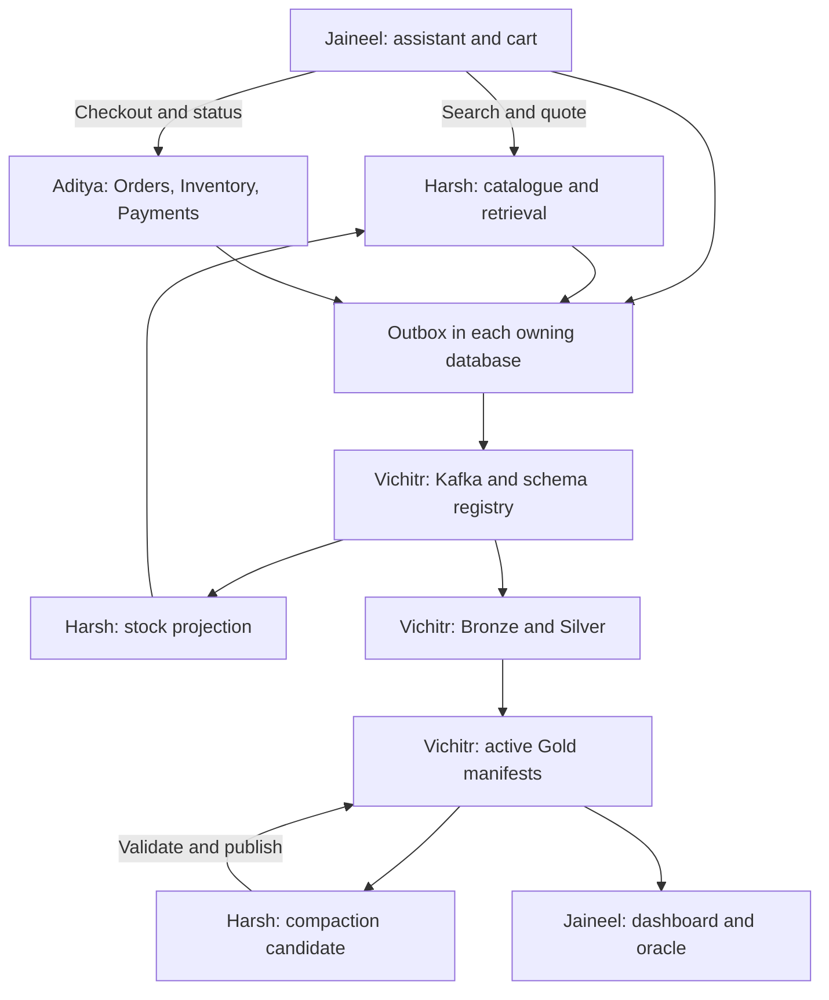

# Common implementation specification

Version 2.0 | 24 October 2026 | Normative for all four developers

Read 01_PROJECT_CONTEXT.md first. This document defines the shared contract. 03_EVALUATION_SPEC.md defines how to measure it; 09_EVALUATION_RUNBOOK.md specifies the commands and evidence to implement. 08_DATASET_PROFILE_AND_RULES.md is the normative source mapping and import policy. Personal work files assign implementation, not alternative interfaces. All names below are proposed implementation contracts; no service currently exists.

## 1. Ownership and boundaries

| Boundary | Owner | Consumers | Sole write authority |
|---|---|---|---|
| Conversation, sessions, cart, workflow | Jaineel | Demo client, benchmark runner | conversation_db |
| CSV ingestion, normalization, catalogue, authoritative price, quotes, retrieval | Harsh | M1, Orders | catalog_db |
| Stock read model used by search | Harsh | Retrieval | catalog_db, fed by Inventory events |
| Orders and saga | Aditya | M1, benchmark runner | orders_db |
| Inventory and reservations | Aditya | Saga | inventory_db |
| Simulated payment attempts and ledger | Aditya | Saga | payments_db |
| Generic outbox storage/relay library | Aditya | M1, M2, M3, M4 quarantine notification | Only the caller’s local database |
| Event builder, schema validation and Kafka transport SDK | Vichitr | All producers and relays | Kafka transport only |
| Bronze, Silver, Gold staging, DLQ, manifest publication, replay | Vichitr | Analytics API, compactor, benchmarks | analytics_db and dataset file store |
| Snapshot compaction and DuckDB scan benchmark | Harsh | M4 publication adapter, benchmark runner | New candidate files only |
| Load generator, independent oracle, monitoring, dashboard, CI/integration harness | Jaineel | Whole team | benchmark artifacts; no business writes except APIs |

No operational service reads another service’s tables. Relationships across databases use IDs plus APIs/events; foreign keys are local only. A single local PostgreSQL server may host the databases, but each application credential must be unable to write the others.

Harsh’s compactor cannot update the active manifest. Vichitr publishes its validated candidate. Jaineel’s dashboard cannot calculate a different meaning of Gold totals or repair data.

### System handoffs

Arrows describe interfaces, not shared database access. The outbox box represents separate local tables in each service, not a central transaction database.

## 2. Repository and runtime contract

| Proposed path | Owner | Contents |
|---|---|---|
| docs/ | Jaineel coordinates; respective authors review | This pack, ADRs, runbook |
| contracts/http/conversation.yaml | Jaineel | Conversation/cart OpenAPI |
| contracts/http/catalog.yaml | Harsh | Search/product/quote OpenAPI |
| contracts/http/transactions.yaml | Aditya | Order/inventory/payment OpenAPI |
| contracts/http/analytics.yaml | Vichitr | Manifest, Gold, DLQ/replay inspection APIs |
| contracts/events/, contracts/dictionaries/events/ | Vichitr; payload owners review | JSON Schema draft-07 per topic, event reason codes/dictionaries |
| contracts/dictionaries/catalog/, contracts/data/catalog/ | Harsh; Jaineel reviews expectations | Frozen source/category/facet mappings, source/catalog/SKU manifest schemas |
| pipelines/catalog/ | Harsh | CSV profiling, normalization, observations, staging/promoting imports and catalogue CLI |
| contracts/fixtures/ | Jaineel; providers review | Valid/invalid requests, event fixtures and expected outputs |
| shared/contracts/ | Domain owner for each DTO | Typed representations of frozen contracts |
| shared/event_transport/ | Vichitr | Validation, event construction, Kafka producer/consumer adapters |
| shared/local_diagnostics/ | Vichitr | Durable service-local diagnostic records and DLQ notification envelopes |
| shared/outbox/ | Aditya | Transaction-local append and restart-safe relay |
| shared/telemetry/ | Jaineel | Timing/counter/log helpers; metric names |
| services/conversation/ | Jaineel | M1 |
| services/catalog/ | Harsh | M2 including stock consumer |
| services/orders/, services/inventory/, services/payments/ | Aditya | M3 and corresponding migrations |
| pipelines/ingestion/, pipelines/curation/, pipelines/gold/, pipelines/replay/ | Vichitr | M4 |
| pipelines/storage/ | Vichitr | Durable file store and active manifest |
| analytics/compaction/, analytics/queries/ | Harsh | Layout transforms and analytical benchmark queries |
| dashboards/, benchmarks/, tests/integration/, tests/oracles/ | Jaineel | Monitoring and experiment harness |
| infra/ | Vichitr | Compose, Kafka, registry and resource profiles |
| migrations/<database>/ | Owning database developer | Ordered migrations only for that database |
| tests/<module>/ | Each owner | Unit, contract and failure tests |
| pyproject.toml, dependency lock, CI workflow | Jaineel | Single application lock and test orchestration |

Service DNS/ports inside Compose: conversation:8001, catalog:8002, orders:8003, inventory:8004, payments:8005, analytics:8006. Kafka internal bootstrap kafka:9092; PostgreSQL postgres:5432; registry schema-registry:8081. Publish only needed localhost ports. External broker advertisement is a separate explicit Compose setting.

Use HTTP/JSON for application commands and Kafka for events. Do not expose Python functions as a cross-process interface. Function contracts later in this document describe provider implementations and consumer adapters.

Every service supplies GET /health/live, GET /health/ready and GET /metrics. Readiness checks required local storage/schema configuration. Analytics lag must not make Orders unready. API endpoints use /v1; internal endpoints use /internal/v1 and an environment-provided service token.

All operations propagate X-Correlation-ID. Benchmark calls additionally use X-Run-ID. Synthetic identity comes from X-User-ID in the local demo. It is not a production authentication system. Request bodies cannot override the authenticated/synthetic principal established by the adapter.

Required configuration families:

- RUN_NAMESPACE, RUN_ID, service-specific DATABASE_URL, KAFKA_BOOTSTRAP_SERVERS, SCHEMA_REGISTRY_URL.
- CATALOG_BASE_URL, ORDERS_BASE_URL, INVENTORY_BASE_URL, PAYMENTS_BASE_URL, ANALYTICS_BASE_URL.
- INTERNAL_API_TOKEN, OUTBOX_POLL_MS, SINK_BATCH_MAX_ROWS, SINK_BATCH_MAX_WAIT_MS.
- GOLD_PUBLISH_INTERVAL_MS, RESERVATION_TTL_SECONDS, QUOTE_TTL_SECONDS.
- DATA_ROOT, CATALOG_SOURCE_PATH, CATALOG_RULES_VERSION=flipkart-v1, CATALOG_DATASET_REVISION, CATALOG_LOAD_MODE (row or copy).
- MODEL_REVISION, EMBEDDING_MODEL_ID, SEARCH_DEFAULT_MODE=lexical, ASSISTANT_MODE=fixed, ALLOW_INTENT_LLM=false, INTENT_LLM_TIMEOUT_MS=1500.
- BENCHMARK_MODE, FAULT_INJECTION_ENABLED; both false outside isolated tests.

Secrets live in an untracked environment file. The sample environment file has placeholders. The single command interface is python -m projectctl, with exact subcommands/flags in 09_EVALUATION_RUNBOOK.md. Jaineel owns the CLI; Vichitr supplies environment/event adapters, Harsh catalogue adapters and Aditya simulator adapters.

## 3. Shared conventions and failures

**IDs:** string UUIDs for requests, events, sessions, carts, quotes, orders, reservations and payments. SKU is an immutable nonempty ASCII identifier of at most 64 characters. For this source, product_id and sku both equal FK-<pid> and identify a catalogue listing. No parent/variant relationship is inferred. source_observation_id=uniq_id preserves observation identity; latest crawl selection is in file 08.

**Money:** signed 64-bit integer minor units, nonnegative, currency INR in v1. INR 2,500 is amount_minor 250000. No binary floating point, client-calculated authoritative totals or implicit currency conversion.

**Time:** timezone-aware RFC 3339 UTC on the wire, UTC microsecond timestamps in storage; monotonic clocks for elapsed durations. event_time is business occurrence time. produced_at is when an immutable event is created, including time spent in its outbox before publication. Replay preserves both.

**Input bounds:** 1–20 unique SKU lines per cart/quote/order; quantity 1–10 per line; unit price 1–1,000,000,000 minor units; total must fit int64. Text input at most 2,000 characters; search top_k 1–20, default 5. Event value limit 64 KiB. Body validation rejects fractional quantities, numeric strings where integers are required, NaN and unknown enum values.

**Common error object:** error.code (stable enum), error.message (human-readable), error.retryable (boolean), error.details (safe field names/IDs only), correlation_id. Never expose SQL/credentials.

| HTTP | Codes/examples | Caller action |
|---|---|---|
| 400 | BAD_REQUEST | Fix request shape |
| 401/403 | UNAUTHORIZED / FORBIDDEN | Fix identity; no retry loop |
| 404 | NOT_FOUND | Treat as absent; do not invent a successful response |
| 409 | IDEMPOTENCY_CONFLICT, CART_VERSION_CONFLICT, QUOTE_EXPIRED, PRODUCT_NOT_SELLABLE, OUT_OF_STOCK, RESERVATION_EXPIRED, ILLEGAL_STATE | Business conflict; inspect current state |
| 422 | VALIDATION_ERROR, UNSUPPORTED_CURRENCY, UNSUPPORTED_FILTER | Correct invalid inputs |
| 429 | RATE_LIMITED | Honor Retry-After and preserve request/idempotency identity |
| 503 | DEPENDENCY_UNAVAILABLE, STORAGE_UNAVAILABLE | Bounded retry of the same operation identity |

Catalogue search timeout: 2 seconds including transport. Participant command timeout: 2 seconds per attempt. Safe GET retries: at most 2, backoff 100 then 300 ms plus seeded jitter in tests. Mutations retry only with the same scoped idempotency key. Client HTTP timeout is never evidence that a transaction failed.

Mutating public requests require Idempotency-Key, 1–128 characters. Scope is (namespace, user_id, operation, key); internal scope is (namespace, order_id, operation, key). Store the canonical request hash and response in the same local transaction as the effect. Same key/same input returns the original resource; same key/different input returns 409. Pending execution returns the same pending resource. Retain keys throughout the dataset/run; no TTL eviction during correctness or replay tests.

Request hashing sorts JSON object keys, preserves array order, rejects nonfinite numbers, and excludes HTTP transport timestamps/headers. Include all business-affecting values. Event deduplication hashes the entire canonical immutable EventEnvelope, including produced_at and event_time; changing those under the same event_id is a conflict. Cart edits use expected_cart_version as well.

## 4. Shared data transfer objects

Fields listed are required unless explicitly nullable or optional.

| Type | Fields and meaning |
|---|---|
| RequestContext | namespace, run_id, user_id, correlation_id, request_id; session_id nullable; trace_id optional |
| ShoppingIntent | query_text; category (approved root slug), size (validated apparel-alpha value), colour, material, max_price_minor, occasion each nullable; optional brand and category_path_prefix:string[] default null; currency=INR. Category/path/facet values use Harsh’s frozen dictionary; unsupported/ambiguous user constraints require clarification, never silent removal |
| Product | product_id, sku, title, category_path_normalized:string[], attributes:map<string,string[]>, quality_flags:string[], dataset_revision, source_pid, source_observation_id, source_crawled_at, currency=INR, currency_source=project_assumption, catalog_version, active; description/category/brand/brand_normalized/size/size_kind/colour/material/seller_id/price_minor/retail_price_minor/rating nullable; inactive_reason nullable only when active=true. Raw CSV/specification cells stay in provenance storage, not API hits |
| ProductHit | sku, product_id, title, category/brand/size/colour/material (nullable), price_minor (non-null), currency, catalog_version, dataset_revision, quality_flags; score; stock_available (integer); stock_version; stock_updated_at; stock_applied_at; retrieval_mode; rank |
| SearchRequest | request_id, session_id, intent: ShoppingIntent, top_k=5, mode=lexical |
| SearchResponse | search_id, hits[], mode, candidate_count, eligible_count, returned_count, exhausted, embedding_revision nullable for nonvector modes, timings_ms {embedding, filter, rank, total}, embedding_calls, served_at |
| CartLine | sku, quantity; display_price_minor nullable and explicitly non-authoritative |
| CartSnapshot | cart_id, session_id, user_id, version, lines[], updated_at |
| QuoteRequest | cart_id, cart_version, lines: CartLine[] |
| QuoteLine | sku, quantity, unit_price_minor, line_total_minor, catalog_version |
| Quote | quote_id, user_id, cart_id, cart_version, lines: QuoteLine[], total_amount_minor, currency, created_at, expires_at |
| CreateOrderRequest | quote_id, session_id; confirmation_id identifying explicit client confirmation |
| OrderSnapshot | order_id, quote_id, user_id, session_id, status, order_version, lines: QuoteLine[], total_amount_minor, currency, reservation_id nullable, payment_id nullable, failure_code nullable, created_at, updated_at |
| ReserveRequest | order_id, items[{sku,quantity}], ttl_seconds=30 |
| ReservationSnapshot | reservation_id, order_id, state, items[{sku,quantity}], expires_at, inventory_receipts[{sku,stock_version}], updated_at |
| AuthorizePaymentRequest | order_id, attempt_number, amount_minor, currency |
| PaymentSnapshot | payment_id, order_id, attempt_number, status, amount_minor, currency, failure_code nullable, created_at, updated_at, debit_id nullable, reversal_id nullable |
| StockSnapshot | sku, on_hand, reserved, available, stock_version, changed_at |
| OperationReceipt | operation_id, resource_id, state, version, applied_at |
| PublishAck | event_id, topic, partition, offset, broker_acked_at |
| FileDescriptor | path, sha256, byte_size, row_count, schema_name, schema_version, partition_values, min_event_time nullable, max_event_time nullable |
| DatasetManifest | namespace, dataset, generation, parent_generation nullable, files: FileDescriptor[], source_ranges[], transform_version, code_commit, input_manifest_ids[], created_at |
| ManifestCandidate | base_generation, candidate_manifest: DatasetManifest, logical_row_digest, row_count, monetary_totals_by_currency, transformation_reason |
| BatchOutcome | source_records, new_valid, duplicate_delivery, invalid, redelivery_noop, durable_offsets_by_partition, pending_export_count |
| ReconciliationResult | passed, counts_by_disposition, missing_ids[], unexpected_ids[], conflicting_ids[], totals_by_currency, invariant_failures[], source_manifest_ids[] |

DTO fields are not permission to put raw user text in analytics. Events store validated slots, IDs and model/prompt versions; synthetic text may appear only in explicitly synthetic evaluation fixtures.

## 5. HTTP APIs: exact producer/consumer handoffs

Common HTTP conventions and errors in §3 apply to every row. Owner publishes OpenAPI plus examples and stub behavior before implementation.

| Owner | Endpoint | Input | Output and semantics |
|---|---|---|---|
| Jaineel | POST /v1/sessions | Empty body; user context | 201 {session_id,cart_id,cart_version:0}; durable session and empty cart |
| Jaineel | POST /v1/sessions/{session_id}/turns | {request_id,text,mode:fixed or assist} | 200 {turn_id,response_text,intent nullable,search_id nullable,products[],proposed_action nullable,outcome,extractor_source,llm_call_count,timings_ms}; see §6.2 for call budgets; never silently purchases |
| Jaineel | GET /v1/carts/{cart_id} | User context | 200 CartSnapshot; only owner’s cart |
| Jaineel | PUT /v1/carts/{cart_id}/items/{sku} | {quantity,expected_cart_version}; quantity 0 means remove | 200 CartSnapshot; 409 for version mismatch; mutation event in same transaction |
| Jaineel | POST /v1/carts/{cart_id}/quote | {expected_cart_version} | 201 Quote via Harsh; cart version checked first |
| Jaineel | POST /v1/carts/{cart_id}/checkout | {quote_id,expected_cart_version,confirmed:true,confirmation_id} | 202 {order_id,status,status_url}; checks quote/cart match and explicit confirmation, then calls Orders |
| Harsh | POST /v1/search | SearchRequest | 200 SearchResponse; empty hits is valid and must not relax hard filters |
| Harsh | GET /v1/catalog/facets | namespace, dataset_revision optional | 200 FacetDictionary with supported root/path/brand/facet values and coverage; cache only by exact dataset_revision |
| Harsh | GET /v1/products/{sku} | SKU | 200 {product:Product,stock:StockSnapshot nullable}; unknown stock is not advertised available |
| Harsh | POST /v1/quotes | QuoteRequest, identity, idempotency key | 201 Quote; read prices/active SKUs in one snapshot; inactive/null-price listing returns 409 PRODUCT_NOT_SELLABLE with reason |
| Harsh | GET /internal/v1/quotes/{quote_id} | Internal token + intended user_id | 200 Quote including expiry; Orders checks binding and validity |
| Harsh | POST /internal/v1/catalog/{sku}/price | {price_minor,expected_catalog_version} | 200 Product; authoritative price change and PRICE_UPDATED outbox event atomic |
| Aditya | POST /v1/orders | CreateOrderRequest + user context/key | 202 {order_id,status,status_url}; validate quote, copy immutable prices, persist order+saga job+outbox, then return |
| Aditya | GET /v1/orders/{order_id} | User context | 200 OrderSnapshot, including nonterminal progress |
| Aditya | GET /v1/orders/{order_id}/events | SSE; optional Last-Event-ID=order_version | Current snapshot first, then versioned state changes; reconnect safely |
| Aditya | POST /internal/v1/reservations | ReserveRequest + internal key | 201 ReservationSnapshot or 409 OUT_OF_STOCK; all SKU lines succeed or none |
| Aditya | GET /internal/v1/reservations/by-order/{order_id} | Internal context | 200 ReservationSnapshot, including a cancellation tombstone if present |
| Aditya | POST /internal/v1/reservations/by-order/{order_id}/commit | {reservation_id} + internal key | 200 committed snapshot or 409 expired/released; authoritative atomic expiry check |
| Aditya | POST /internal/v1/reservations/by-order/{order_id}/release | {reason} + internal key | 200 released/expired snapshot; create cancellation tombstone if reserve has not arrived; 409 ALREADY_COMMITTED if sale committed |
| Aditya | GET /internal/v1/inventory/{sku} | Internal context | 200 StockSnapshot; oracle/reconciliation reads |
| Aditya | POST /internal/v1/payments/authorize | AuthorizePaymentRequest + internal key | 202 PaymentSnapshot; durable PENDING attempt, simulated provider completes later |
| Aditya | GET /internal/v1/payments/by-order/{order_id} | Internal context | 200 {attempts:PaymentSnapshot[],quiesced:boolean,net_debit_minor} |
| Aditya | POST /internal/v1/payments/by-order/{order_id}/reverse | {reason} + internal key | 200 {quiesced:true,net_debit_minor:0,attempts[]}; cancel pending attempts, reverse a successful debit once, prohibit new attempts |
| Vichitr | GET /v1/analytics/manifests/{dataset}/active | namespace; dataset=silver or gold | 200 DatasetManifest or 404 before first publication |
| Vichitr | GET /v1/analytics/gold/{table} | namespace, date_from inclusive, date_to exclusive, optional currency | 200 {generation,rows[],queried_at}; read only active-manifest files |
| Vichitr | GET /internal/v1/analytics/receipts | namespace, after_cursor, limit<=1000 | Paginated event/source dispositions, stage times, visibility generation; used by harness |
| Vichitr | POST /internal/v1/analytics/replays | {source_manifest_ids[],target_namespace,transform_version} | 202 {replay_id,status_url}; target must be isolated and empty |
| Vichitr | GET /internal/v1/analytics/replays/{replay_id} | Internal context | 200 {status,counts,reconciliation nullable,error nullable} |
| Vichitr | GET /internal/v1/analytics/quarantine | namespace, cursor, limit<=1000 | Reason codes, raw locators and validation diagnostics; no arbitrary raw SQL |

Do not add a public arbitrary SQL endpoint. Test-only stock seeding, payment-delay and crash hooks are available only with BENCHMARK_MODE and FAULT_INJECTION_ENABLED in an isolated namespace.

**Quote policy:** TTL 60 seconds. A quote is an explicit price promise honored if Orders accepts it before expiry; subsequent catalogue changes do not rewrite accepted order prices. Availability shown during quoting is advisory. Inventory always checks current stock. M1 displays the exact quote before confirmation. A stale cart version requires a new quote and confirmation. At order acceptance, Orders fetches the quote through Harsh’s API and uses server time, not client timestamps.

**Notification policy:** Aditya uses order-versioned SSE with a durable state snapshot and PostgreSQL notifications as a wake-up hint. Notifications are not the source of truth. Reconnect returns the latest state even if intermediate notifications were missed; a periodic reconciliation read may be used. The benchmark may poll at a fixed documented interval, but includes that interval in observed latency.

## 6. Provider function contracts

These are interface signatures, not implementation code. Pure helpers return typed values or a named validation error. Side effects are stated explicitly.

### 6.1 Shared transport and outbox

| Function | Owner | Contract |
|---|---|---|
| build_event(event_type, payload, context, aggregate_type, aggregate_id, aggregate_version, event_time) → EventEnvelope | Vichitr | Allocate event_id and produced_at once; validate immutable event; do not publish |
| validate_event(raw_bytes, headers, topic, key) → ValidEvent or ValidationFailure | Vichitr | Validate wire/schema/topic/key rules and return stable reason codes; no DB writes |
| publish_event(event, topic, key) → PublishAck | Vichitr | Return only after broker delivery confirmation; raise RetryablePublishError on uncertainty; bounded queue, no silent drop |
| consume_records(group, topics, max_records, max_wait_ms) → SourceRecord[] | Vichitr | Manual offset management; include raw bytes and source coordinates |
| commit_offsets(group, durable_next_offsets) → CommitResult | Vichitr | Commit only highest contiguous durable prefix per partition |
| append_outbox(db_transaction, event) → outbox_id | Aditya | Uses caller’s existing transaction; never commits it and never calls Kafka |
| relay_once(service_db, publisher, limit) → RelayResult | Aditya | Read pending rows, publish exact stored event, mark published after ack; duplicate publication permitted |
| recover_pending_outbox(service_db) → RecoverySummary | Aditya | Reclaim abandoned relay claims; no new event IDs or timestamps |
| quarantine_local_diagnostic(db_transaction, diagnostic) → diagnostic_id | Vichitr | Persist local diagnostic and DLQ notification outbox in caller-owned database; never write analytics_db from a different service |

Each service owns its outbox table and migrations. All use the same library. Jaineel and Harsh invoke append_outbox inside their local transactions; Aditya implements the mechanism, not their domain payloads.

Default relay: one active relay per service database, enforced by a PostgreSQL advisory lock held on a dedicated connection. A second relay remains standby. Read committed rows in sequence order, publish each aggregate’s rows in order, and do not skip an earlier failed row for that aggregate. The publish-before-mark crash can repeat an event; all consumers must tolerate it. Aggregate versions make consumers robust even if later scaling changes publication order. Parallel relays are outside the required optimization matrix.

### 6.2 M1 and M2

| Function | Owner | Inputs, outputs, effects |
|---|---|---|
| dispatch_turn(turn_request, context) → TurnResponse | Jaineel | Deterministic fixed workflow or one-call assist fallback; persist turn outcome and events; no free-running planner loop |
| extract_intent(text, context) → IntentResult | Jaineel | Rules/dictionary extraction first; optional single schema-constrained fallback under the policy below; return validated intent or clarification_required, never executable instructions |
| compose_response(intent, search_response, action_status) → response_text | Jaineel | Deterministic templates only; zero model calls; product facts come only from supplied hits/quotes/status |
| update_cart(cart_id, sku, quantity, expected_version, context) → CartSnapshot | Jaineel | Local cart mutation+event+idempotency atomic |
| request_quote(cart_id, expected_version, context) → Quote | Jaineel | Calls Harsh’s quote API; does not calculate authoritative totals |
| checkout_cart(cart_id, quote_id, expected_version, confirmation, context) → OrderAccepted | Jaineel | Calls Aditya’s API with stable key; never handles stock/payment itself |
| profile_catalog(source_path, rules_version) → CatalogProfile | Harsh | Read complete file; counts, types, source checksum, nested shapes and facet coverage; no service writes |
| normalize_catalog_row(raw_row, source_ref, dictionaries) → NormalizedObservation | Harsh | Pure deterministic rules from file 08; normalized row, raw locator and quality issues; no LLM/network |
| select_latest_listings(observations) → SelectionResult | Harsh | Select latest pid observation; retain exclusive disposition per source row and conflict diagnostics |
| load_catalog(source_manifest, normalized_manifest: NormalizedCatalogManifest, load_mode, namespace) → CatalogLoadReport | Harsh | Idempotent bounded staging, durable checkpoints, atomic promotion; load_mode=row or copy; unchanged content is a no-op |
| export_sku_manifest(dataset_revision, namespace) → SkuManifest | Harsh | Sorted active SKU set and source lineage; excludes inactive prices, includes no stock guesses |
| get_facet_dictionary(dataset_revision) → FacetDictionary | Harsh | Frozen supported values, null coverage and path prefixes for M1 and the evaluator |
| build_embeddings(catalog_version, model_revision) → EmbeddingManifest | Harsh | Offline deterministic input text and frozen model; record hashes/dimensions; no timed model download |
| filter_catalog(intent, snapshot) → EligibleProducts | Harsh | Hard category/path/brand/size/colour/material/price/active/availability constraints; null cannot satisfy a requested attribute |
| exact_search(query_vector, eligible_products, limit) → RankedCandidates | Harsh | Exact cosine distance with SKU tie-break; no HNSW plan |
| ann_search(query_vector, intent, limit, ann_config) → RankedCandidates | Harsh | HNSW only in ANN variants; record parameters, shortages and fallback |
| fuse_rrf(lexical_ranked, vector_ranked, k=60, top_k=5) → ProductHit[] | Harsh | Rank starts at 1; sum 1/(60+rank) over lists; SKU tie-break; only already eligible SKUs |
| search_catalog(request, context) → SearchResponse | Harsh | Implements /v1/search and persists retrieval outcome event locally |
| create_quote(request, context) → Quote | Harsh | Snapshot current prices; persist immutable quote and idempotency response |
| apply_stock_event(valid_event, source_record) → ProjectionResult | Harsh | Atomically apply newer SKU version and dedup receipt; duplicate/stale/conflict distinguished |

**M1 latency and model-call policy (required):** fixed is the default. Parse explicit filters with deterministic rules and Harsh's versioned dictionaries; retain unstructured product terms as query_text. If an ambiguity could change a hard constraint, return a targeted clarification. In assist mode only, when ALLOW_INTENT_LLM=true and rule extraction requires help, make at most one schema-constrained intent-extraction call, with a 1,500-ms timeout and no automatic model retry/repair. Validate its output against the same contract. Timeout/invalid/unsupported output returns clarification and a diagnostic, not a second call. Preserve any explicitly parsed hard constraints; model output cannot relax them. Fixed mode must run with the provider unavailable.

One search per search turn, no recursive tool selection, no generative response composition, no per-product/per-row LLM calls. Cart/quote/checkout/status actions use explicit API controls and zero model calls. A model never decides to purchase. Limit a turn to 3,000 ms overall, allocating the remaining deadline to the one search call; dependency failure is visible. Do not retry beyond the remaining turn deadline. Backend durable checkout remains asynchronous and is not cancelled by a turn timeout. Structured search bypasses the intent stage entirely.

Turn timing fields are parse, llm, search, compose and total in milliseconds, measured with monotonic elapsed timers; llm_call_count is 0 or 1, extractor_source is rules or llm or clarification, outcome is success/clarification/dependency_error. A disabled/not-executed model contributes zero calls and no model-latency sample. Record provider/model/prompt revisions and actual returned usage only when called. No cache of price/stock/search results. Core comparisons disable optional intent/query caches; future cache trials require a separate variant and hit/miss timing. Local query embedding, if requested, is a separate measured inference operation, not a generative call.

### 6.3 M3 and M4

| Function | Owner | Inputs, outputs, effects |
|---|---|---|
| create_order(request, context) → OrderAccepted | Aditya | Valid quote → order, items, durable saga job, idempotency record and outbox in one Orders transaction |
| advance_saga(order_id) → SagaProgress | Aditya | Resume durable planned step, issue stable participant commands, persist outcomes |
| seed_inventory(sku_manifest, seed_config, context) → SeedReport | Aditya | Offline/test-only; verify manifest; create simulator stock and STOCK_UPDATED outbox atomically in bounded chunks; same seed is a no-op, no re-parse of CSV |
| reserve_inventory(request, context) → ReservationSnapshot | Aditya | Lock SKU rows in sorted order; all-or-nothing capacity check |
| commit_reservation(order_id, reservation_id, context) → ReservationSnapshot | Aditya | Serialize against expiry/release; consume stock once |
| release_inventory(order_id, reason, context) → ReservationSnapshot | Aditya | Release ACTIVE stock or create tombstone; never release COMMITTED sale |
| expire_reservations(now) → ExpirySummary | Aditya | Uses authoritative DB clock under locks; expire ACTIVE only; emits snapshots |
| authorize_payment(request, context) → PaymentSnapshot | Aditya | Durable simulated attempt; no real payment gateway |
| complete_simulated_payment(payment_id, outcome) → PaymentSnapshot | Aditya | Single locked state transition; cancelled/reversed/quiesced attempts cannot become successful later |
| compensate(order_id, reason) → SagaProgress | Aditya | Establish released/expired reservation first, then quiesce/reverse payment; see §9 |
| ingest_bronze(records) → RawBatchReceipt | Vichitr | Durably preserve exact record bytes and metadata before sink processing |
| curate_silver(raw_receipt, batch_config) → BatchOutcome | Vichitr | Validate, normalize, durable dedup, typed facts, Gold staging, quarantine and contiguous receipts |
| aggregate_gold(new_facts, db_transaction) → DirtyPartitionSet | Vichitr | Idempotent reducers in same transaction as fresh Silver insertion |
| publish_snapshot(namespace) → DatasetManifest | Vichitr | Freeze consistent staging snapshot, create files, validate and atomically publish manifest |
| route_dlq(source_record, validation_failure, db_transaction) → quarantine_id | Vichitr | Durable quarantine plus DLQ notification outbox in the same analytical transaction |
| replay_bronze(request) → ReplayJob | Vichitr | Reuse validation/reducer rules in isolated namespace; no operational commands |
| compact_snapshot(manifest, layout_config, output_prefix) → ManifestCandidate | Harsh | Immutable candidate files preserving logical rows; never swaps active manifest |
| publish_candidate(candidate) → DatasetManifest | Vichitr | Verify equivalence and compare-and-swap base_generation; reject stale candidates |
| observe_run(run_config) → ObservationStream | Jaineel | Collect independent client timings, per-stage receipts, lag and resources |
| reconcile_run(expected, observed) → ReconciliationResult | Jaineel | Independent oracle; never imports production reducers |

## 7. Event contract and governance

Topics are <namespace>.<domain>.v1, where domain is conversation-events, retrieval-events, order-events, inventory-events or payment-events. The namespace is dev or a unique bench-/replay- identifier. Topic retention: 7 days in the local profile. Benchmark topics are created before a run, never repartitioned mid-run.

**EventEnvelope fields**

| Field | Type / rule |
|---|---|
| event_id | UUID; immutable through retry and unmodified replay |
| event_type | Registered event enum below |
| schema_version | Integer major version; 1 in v1 |
| event_time | UTC business timestamp |
| produced_at | UTC event creation timestamp; never reset by relay |
| namespace, run_id | Nonempty bounded strings; required, propagated across services |
| source_service | conversation, catalog, orders, inventory, payments or benchmark |
| correlation_id | UUID linking a user operation |
| session_id, user_id | Nullable synthetic IDs; mandatory for conversation/retrieval session facts |
| aggregate_type, aggregate_id | session, search, order, sku or payment_attempt and its ID |
| aggregate_version | Positive int64, monotonic within source_service+aggregate_type+aggregate_id |
| payload | Registered typed object |
| metadata | Object; dataset_revision required for catalogue-linked facts; synthetic=true for simulator/load facts, scenario_source=simulation or benchmark; optional model/prompt revisions and padding for labelled synthetic load only. Never treat crawl_timestamp as new event_time |

Transport is **plain UTF-8 JSON**, not Confluent binary framing. Kafka headers contain content-type=application/json and schema-id as UTF-8 decimal; key is the documented UTF-8 aggregate key. A shared SDK registers/fetches JSON Schemas through Schema Registry and performs validation itself. Do not combine a binary serializer with a consumer expecting raw JSON.

One JSON Schema subject per topic domain and major version, named <domain>.v1-value, independent of run namespace. The topic schema selects payload rules by event_type. A registry manifest maps subject, registry ID and schema SHA-256. Configure BACKWARD_TRANSITIVE and prove compatibility with old/new fixtures; JSON Schema changes are not automatically safe just because a field is optional. Consumer envelope/payload models ignore unknown optional properties but enforce known required fields and types. Breaking semantics, deleted required fields, unknown major versions or new unsupported event types require an explicit migration/major version. Producers validate their own complete payloads.

Schemas are loaded and checksum-verified before readiness, then cached. Do not make one registry HTTP request per event. Registry downtime with a verified cache does not stop an established run; new/unknown schema IDs are quarantined rather than guessed. A fresh service without its registry/cache mapping is not ready.

**Canonical event catalogue**

| Topic domain / key | Events | Required payload fields beyond envelope |
|---|---|---|
| conversation-events / session_id | CONVERSATION_TURN | turn_id, mode, outcome, duration_ms, llm_call_count (0 or 1), extractor_source; no raw free-form text |
| conversation-events / session_id | INTENT_EXTRACTED | turn_id, intent: ShoppingIntent, extractor_version, outcome=valid |
| conversation-events / session_id | INTENT_REJECTED | turn_id, reason_code, extractor_version, restricted diagnostic reference |
| conversation-events / session_id | TOOL_CALLED | turn_id, tool_call_id, tool_name, outcome, duration_ms; no secrets |
| conversation-events / session_id | ADD_TO_CART | cart_id, cart_version, sku, quantity_after |
| conversation-events / session_id | CHECKOUT_STARTED | cart_id, quote_id, order_id, confirmation_id |
| retrieval-events / session_id | SEARCH_REQUESTED | search_id, intent, mode |
| retrieval-events / session_id | PRODUCT_RETRIEVED | search_id, skus[], returned_count, mode, duration_ms |
| retrieval-events / session_id | PRODUCT_COMPARED | comparison_id, skus[], field_names[] |
| retrieval-events / sku | PRICE_UPDATED | sku, price_minor, currency, catalog_version |
| order-events / order_id | ORDER_CREATED, ORDER_CONFIRMED, ORDER_CANCELLED | order_id, order_status, total_amount_minor, currency, created_at, user_id, session_id, quote_id, failure_code nullable; confirmed also reservation_id,payment_id |
| inventory-events / sku | STOCK_UPDATED, INVENTORY_RESERVED, INVENTORY_RELEASED, INVENTORY_EXPIRED, INVENTORY_COMMITTED, INVENTORY_REJECTED | sku,on_hand,reserved,available,stock_version,changed_at,order_id nullable,reservation_id nullable,reason_code nullable |
| payment-events / order_id | PAYMENT_PENDING, PAYMENT_SUCCESS, PAYMENT_FAILED, PAYMENT_CANCELLED, PAYMENT_REVERSED | payment_id,order_id,attempt_number,status,amount_minor,currency,attempt_created_at,failure_code nullable,debit_id nullable,reversal_id nullable |

PRODUCT_COMPARED is emitted only if the minimal compare action is implemented; absence must not fabricate an event. Every stock event is a full absolute snapshot, not a delta. Increment the SKU version for each emitted inventory fact, even a rejected reservation fact whose stock counts are unchanged. A multi-SKU reservation emits one fact per SKU in its local transaction. Payment aggregate version is per payment attempt although the Kafka key is order_id.

SEARCH_REQUESTED and PRODUCT_RETRIEVED share a search_id. M2 owns both; M1 must not emit a duplicate logical search event. Harsh owns PRICE_UPDATED because catalogue prices are authoritative there. Inventory owns stock; these are independent version streams. There is no need for a separate asynchronous price copy inside the same catalogue database.

Five domain topics can contain different aggregate types. Ordering is per partition, not global and not across topics. M2 directly consumes inventory-events in its own group, independently of M4 analytics. Stock freshness must not depend on Gold completing.

For inventory snapshots, envelope.aggregate_version must equal payload.stock_version; PRICE_UPDATED uses catalog_version the same way. Order state uses the envelope version as order_version. Each source may emit only its owned event types; source_service=benchmark is accepted only in isolated benchmark namespaces with metadata.synthetic=true. The stock projection accepts real Inventory snapshots in its own namespace, not arbitrary synthetic benchmark facts from a pipeline-only run.

Producer-side validation failure does not create a valid domain event. For malformed model output, Jaineel stores a restricted diagnostic record and a valid INTENT_REJECTED event. For externally injected malformed wire bytes, M4 archives bytes and quarantines the source record. Never silently coerce malformed content into a successful event.

## 8. Persistence and immutable correctness rules

Each owner creates migrations and read-only audit queries for these logical tables. All primary keys include namespace where data from more than one namespace shares a physical table.

| Database | Required tables / key constraints |
|---|---|
| conversation_db | sessions(session_id), carts(cart_id,version), cart_items(cart_id,sku), turns(request_id unique), operation_keys(scoped key unique), local_diagnostics, outbox(event_id unique) |
| catalog_db | products(sku PK,product_id,source IDs,source_crawled_at,dataset_revision,category,category_path,nullable attributes/price,quality_flags,catalog_version,active,nullable embedding vector(384),embedding_revision), catalog_imports(import_id,source_hash,rules_version,status), catalog_stage(import_id,source_row PK,sku unique within import), catalog_import_chunks(import_id,chunk_no PK), source_observations(source_hash,row_no PK), source_dispositions(source_hash,row_no PK), stock_projection(sku PK,stock_version,counts), projection_receipts(topic,partition,offset unique), projection_event_ids(event_id unique,content_hash), quotes(quote_id), quote_lines(quote_id,sku), operation_keys, local_diagnostics, outbox |
| orders_db | orders(order_id,order_version,status,quote_id,user_id,session_id,total,currency), order_items(order_id,sku), saga_jobs(order_id unique,planned_step,attempt,next_attempt_at,last_error), operation_keys, outbox |
| inventory_db | inventory(sku,on_hand,reserved,stock_version), inventory_seeds(seed_id,manifest_hash,profile_hash,status), inventory_seed_chunks(seed_id,chunk_no unique), reservations(order_id unique,reservation_id unique,state,expires_at), reservation_items(reservation_id,sku,quantity), operation_keys, outbox |
| payments_db | payment_orders(order_id unique,quiesced), payment_attempts(payment_id,order_id,attempt_number unique per order,status), ledger_entries(entry_id,payment_id,kind,amount_minor), operation_keys, outbox |
| analytics_db | source_receipts(namespace,topic,partition,offset PK,raw locator,disposition), silver_events(namespace,event_id PK,content_hash,typed fields,normalized payload), gold reducer state, quarantine, outbox, export_pending, snapshot_manifests, active_datasets, visibility_receipts, processing_runs |

Essential indexes/constraints exist in B0 and all variants:

- Primary keys, scoped idempotency keys, event_id uniqueness, local foreign keys and monetary/quantity checks.
- Local join indexes for order items, reservation items, payment attempts and manifest references.
- Pending outbox index on unpublished rows; pending/expiry job indexes; analytical dedup and publication bookkeeping indexes.
- Uniqueness for one debit and at most one reversal per successful payment, and a payment_orders row lock to prevent two successful/pending attempts for one order.
- Inventory invariant: 0 <= reserved <= on_hand; available = on_hand - reserved. Never maintain an independently mutable available counter.
- Uniqueness for each event’s Gold contribution and each source record’s disposition.
- One accepted order per (namespace,user_id,quote_id). A repeated accepted quote resolves to that same order even with a new client transport key. Check prior idempotency/quote consumption before rejecting a retry because the original quote has since expired.

The optional experiment index is products(namespace, category, price_minor), with namespace fixed in each query. Its workload comparison is category equality plus a price range. B0 does not remove necessary integrity indexes to make itself artificially slow. No HNSW index in the exact baseline. Index changes go into separate variant migrations, leaving base migrations identical.

All persisted amounts use int64; summed reporting amounts use an exact sufficiently wide numeric accumulator and check overflow before conversion. Null means unknown/not applicable, never zero.

**Inventory conservation:** opening stock + explicit replenishment - committed sold quantities = current on_hand. reserved equals the sum of ACTIVE reservation item quantities, including physically held expired-but-not-yet-swept rows until expiry/release commits. A commit must still reject an expired row even before the sweeper processes it.

**Financial conservation at quiescence:** a CONFIRMED order has exactly one unreversed successful debit equal to its immutable order total. A CANCELLED order has net debit zero. A still-PENDING or MANUAL_REVIEW order is unresolved, not successful. Multiple transport retries are one attempt. A new logical attempt is allowed only after a definitive failure.

## 9. Durable checkout and compensation protocol

### 9.1 Normal path

1. Orders verifies the catalogue quote’s user, currency, expiry and lines, and stores an immutable order snapshot. One Orders transaction writes ORDER_CREATED, its outbox record and a runnable saga job. HTTP returns 202 after this commit.
2. Saga transitions to RESERVING and calls Inventory using operation key order_id:reserve:v1. The command must be recorded durably before the call so restart repeats the same operation.
3. Inventory reserves all lines atomically. Lock SKUs in sorted order to reduce deadlocks. Default TTL is 30 seconds. The expiry check uses the current database clock after locks are acquired.
4. Saga transitions to PAYMENT_PENDING and calls Payments with key order_id:authorize:1. Payment is a simulated debit workflow: SUCCESS means a simulated debit, not a real bank authorization. The historic function name authorize_payment is retained.
5. If payment succeeds, Saga records COMMITTING_STOCK before calling Inventory with key order_id:commit:v1.
6. Inventory atomically verifies ACTIVE and expires_at > current clock, marks COMMITTED, reduces on_hand and reserved by each quantity, emits full stock snapshots, and returns a durable receipt.
7. Only after a COMMITTED reservation receipt and SUCCESS payment does Orders mark CONFIRMED and publish ORDER_CONFIRMED. Once inventory is COMMITTED, recovery must complete confirmation forward; it must not later “expire” or release that sale.

Orders legal states: PENDING → RESERVING → PAYMENT_PENDING → COMMITTING_STOCK → CONFIRMED. Any pre-commit failure may enter COMPENSATING → CANCELLED. MANUAL_REVIEW means unresolved infrastructure/reconciliation failure and is not terminal success. Persist failure reason and intended recovery action.

Reservations legal states: ACTIVE → COMMITTED, RELEASED or EXPIRED. RELEASED/EXPIRED cannot become ACTIVE again. A release arriving before a delayed reserve creates an order-scoped cancellation tombstone; that delayed reserve must fail. COMMITTED cannot be released in this v1 checkout protocol. Returns after purchase are a separate future workflow.

### 9.2 Payment retries and uncertain responses

A simulated provider worker completes PENDING attempts after a deterministic configured delay. Payment state changes and events are local transactions. A payment_orders row serializes attempts and compensation.

- A network timeout leaves the outcome UNKNOWN to the caller; query the same order/attempt and retry the same key.
- Do not generate a new payment ID/key because an HTTP response was lost.
- Allow at most two logical attempts per order. Attempt 2 is permitted only after attempt 1 has definitively FAILED with RETRYABLE_PROVIDER_FAILURE and the reservation is still ACTIVE/unexpired.
- DECLINED, invalid input or expired stock triggers compensation. No automatic retry for a business decline.
- Only one attempt may be PENDING or SUCCESS for an order. A successful attempt creates exactly one debit ledger entry. No further attempts after SUCCESS or quiesced=true.
- reverse atomically sets the order’s payment guard quiesced=true, cancels PENDING attempts, and adds one reversal for an existing SUCCESS. Future callbacks cannot create a debit after that guard is set.
- If a late success wins the lock before reverse, reverse sees and reverses it. If reverse wins first, the late callback becomes a no-op. Both races must be tested.

No real gateway is integrated, so the test demonstrates the simulator’s contract. Do not generalize this to guarantees from an external bank.

### 9.3 Compensation and the expiry race

A “check expiry, then confirm later” sequence is insufficient. Expiry, commit and release must serialize in Inventory.

Compensation first calls Inventory release-by-order, including when the original reserve response was lost.

- If release/expiry wins, the reservation cannot later commit. Then Payments is quiesced/reversed. Orders becomes CANCELLED only after both proofs are durable.
- If inventory reports ALREADY_COMMITTED, compensation must stop. Reconcile the successful payment and finish confirmation forward; do not refund a committed sale as a generic timeout reaction.
- If inventory state is unknown because the service is down, remain COMPENSATING/MANUAL_REVIEW and retry. Never mark CANCELLED while the commit outcome is uncertain.
- Expiry sweeper checks ACTIVE rows every 250 ms. Saga also checks reservation state while waiting on payment, so expiry recovery does not depend on Kafka delivery.
- The expiry/commit check uses actual time after row locks are held, not a transaction-start timestamp that may have become stale.
- One failed line releases the complete multi-SKU reservation. No partial confirmation.

Use a per-order advisory lock or equivalent durable worker claim plus optimistic order_version updates to avoid concurrent saga runners. Do not hold a business database transaction open across network calls. Participant tombstones and terminal state checks remain necessary for delayed in-flight calls.

Retry transient failures with exponential backoff starting at 100 ms, capped at 2 seconds. After 60 seconds of unresolved recovery, surface MANUAL_REVIEW and an alert; keep a durable retry task. The benchmark’s drain timeout does not authorize deleting pending work.

### 9.4 Outbox crash behavior

| Crash point | Required result |
|---|---|
| Before business/outbox transaction commit | Neither effect nor event persists |
| After commit, before relay publish | Pending outbox eventually publishes |
| After broker accepted, before relay marks published | Same event may publish again; one business/analytical effect |
| After relay marks published | Acknowledged broker record and original outbox evidence remain |
| Two relays started | One active lock holder; standby does not duplicate active work |
| Kafka temporarily down | Business state still commits with pending local outbox, until explicitly declared storage/admission limits |

Outbox retention is 7 days after confirmed publication in the local profile, and never shorter than an active test/replay audit. Unpublished rows are never deleted. The failure benchmark reports backlog and capacity; it does not promise unlimited buffering.

## 10. Catalogue, retrieval and stock projection

**Catalogue source:** use flipkart_com-ecommerce_sample.csv and the exact rules/checksum in 08_DATASET_PROFILE_AND_RULES.md. Preserve 20,000 source observations; select 19,998 latest-pid listings; retain 78 inactive missing-price rows; export 19,920 active candidates. The earlier 10,000-row synthetic catalogue is superseded. Only load/stress fixtures may clone rows under new synthetic IDs. Do not relabel them as additional real products.

Harsh owns CSV import/normalization and the canonical catalogue. Vichitr owns Kafka event ingestion/normalization and supplies FileStore. Aditya seeds simulated inventory from Harsh's SkuManifest; Jaineel owns traffic and independent evaluation. Source rows, catalogue rows and event records have separate identities and disposition ledgers.

Import staging: serialize imports for a namespace/source with a database advisory lock. Validate/select before load; stage chunks of 1,000 canonical rows with checkpoint and row hashes in the same transaction. I0 issues one parameterized INSERT per staged row; I1 uses PostgreSQL COPY into the identical stage schema per chunk. Both use the same commit boundaries, validation, indexes and final set-based promotion. The last short chunk is valid. Promote and mark import complete atomically after counts/digests reconcile; only then mark the catalogue ready and publish SkuManifest. After interruption, verify the staged chunk hash and resume; a same-source/rules completed import is a no-op. Initial imports and experiments run before traffic in an isolated namespace; live source refresh while orders run is outside this release. Never turn a repeated import into an inventory reset.

Description, brand, category and facets may be null. Missing price makes the listing inactive; no price imputation. Source specifications are parsed deterministically, not sent to an LLM. A strict requested size often has no matches because only four listings provide a usable apparel size under the selected rule. Keep unknown values and coverage visible; do not relax filters to manufacture a result.

Optional embedding text template v2: title, known category path, brand, verified material/colour/occasion specification values, then description, in that fixed order with field separators. Remove only explicit `Price: Rs.`/`Price: INR` numeric fragments from description using a frozen tested pattern; do not strip arbitrary dimensions/numbers. Record exact resulting text hashes and tokenizer truncation (maximum 256 tokens including special tokens for the frozen model). Structured current price and stock are excluded. Re-embed only when text/model/template hashes change. Build catalogue vectors offline; load/prewarm the model once per worker; batch document encoding with a recorded bounded batch size. No catalogue/model download or product re-embedding inside a request. Query embedding is local and measured separately.

**Search modes**

- filter_only: apply hard filters; order by price_minor then SKU.
- vector_exact: apply hard filters; exact cosine ranking; SKU tie-break.
- lexical (default operational mode): apply hard filters; PostgreSQL full-text rank over title+description; SKU tie-break.
- hybrid_exact (secondary semantic-retrieval mode): lexical top 100 plus exact vector top 100, fuse with RRF k=60, return top_k.
- hybrid_ann: same lexical branch and RRF, HNSW vector branch; explicit experiment only.

“Vector only” is a ranking ablation, not permission to ignore user constraints. Occasion guides semantic ranking; category/root, category path prefix, brand, size, colour, material and maximum price are hard filters when non-null. active=true and available>0 are always required for sale suggestions. Unknown projection is unavailable. Valid canonical size values remain valid filters even if the observed catalogue has no such listing: return empty hits. brand compares brand_normalized; string facets use the exact normalized whole value. Missing optional product values never match. An unsupported field/size syntax returns 422 UNSUPPORTED_FILTER on the structured API; M1 requests clarification. No guessed unit/size-scale conversion.

No lexical GIN index in the core B0/O2 comparison; keep lexical implementation unchanged while adding only the specified B-tree. A future lexical-index experiment gets its own label.

Exact-vs-ANN evaluation freezes query embeddings and eligible sets. HNSW variants record construction and search parameters, iterative scan mode and any exact fallback. Primary ANN quality trials disable fallback to reveal shortages. A separate deployed fallback policy may rerun exact search if fewer than top_k eligible hits are returned, but must include fallback frequency/cost and a different variant ID.

**Projection apply transaction**

1. Validate schema/key/source and archive/record errors through the shared mechanism.
2. Deduplicate event_id with its content hash. Same ID/different content is a conflict.
3. Compare stock_version to the stored SKU version. Greater replaces the complete snapshot; equal identical is a no-op; equal conflicting is quarantine+alert; lower is stale no-op.
4. Commit projection and source receipt before committing the Kafka offset.
5. On initial startup, consume seeded STOCK_UPDATED facts from the beginning of that namespace. Readiness for sale suggestions requires seeded SKUs to have projections. Unknown SKUs are held/reconciled after catalogue load, not guessed.

Per-SKU versions are independent of price/catalogue versions. A missing intermediate inventory version is recorded as a gap, but a newer full snapshot can safely replace the old state. Count stale/gap events; do not treat them as lost money.

## 11. Raw ingestion, durable Silver and analytical publication

### 11.1 File store and source records

Required storage adapter: durable local filesystem volume. FileStore exposes write_immutable(path, bytes, sha256) → FileDescriptor, read(path), exists_with_hash(path,sha256), and list_orphans(manifest_set). Writes use temporary files, file fsync, atomic rename on the same filesystem, and directory fsync. Existing immutable paths with different hashes are an error.

Bronze stores JSONL wrappers containing original key/value/header bytes encoded as base64, topic, partition, offset, broker timestamp, ingested_at, namespace, raw hash and capture file/row locator. Parsed JSON is supplementary; it does not replace original bytes. Preserve malformed UTF-8/JSON.

Physical capture chunks are capped at 1 MiB or 50 ms and kept identical across sink-batching variants. Multiple source partitions may share a capture file, but every record retains its coordinates. Immutable chunk paths include a UUID; duplicates/orphans after crashes are allowed physically, but the source receipt ledger defines one logical source record.

A redelivered Kafka offset is the same source record. Republishing the same event_id to a new offset is another delivery of one logical event. These must not be conflated.

### 11.2 Sink transaction protocol

For each bounded sink batch:

1. Write/verify Bronze chunks durably.
2. Start an analytical database transaction.
3. For each new source coordinate, validate envelope, payload and semantics. Existing source coordinate with matching raw hash is redelivery_noop; mismatched hash is a hard corruption error.
4. For valid input, insert Silver by (namespace,event_id). Same ID/same canonical content is duplicate_delivery. Same ID/different content is EVENT_ID_CONFLICT and quarantine.
5. Only newly inserted valid events enter Gold reducers. Insert reducer contribution keys, update staging/facts and mark affected logical partitions/export_pending in the same transaction.
6. For invalid input, write quarantine with stable reason, locator and original hash; enqueue its DLQ notification through the shared outbox in that transaction.
7. Save durable source dispositions/receipts and commit.
8. Commit Kafka offsets only through each partition’s highest contiguous durable source record plus one.

If the process dies after step 7 but before step 8, redelivery is a no-op. If it dies before step 7, the batch is retried and orphan Bronze files remain unreachable until cleanup. If the analytical transaction fails, do not advance offsets. A malformed row must not poison all valid rows forever: validate/classify rows first, and isolate unexpected constraint failures for diagnosis rather than silently dropping a batch.

Consumer rebalance: stop taking new work for revoked partitions, finish or roll back bounded in-flight work, then commit only durable prefixes. Never commit the largest observed offset when an earlier record is not durable. Poll/heartbeat handling must remain healthy during sink delays.

### 11.3 Gold staging versus visible Gold

Silver rows and Gold staging are durable after the sink transaction, but **the headline Kafka-to-Gold benchmark ends only when the event’s contribution is in queryable, active-manifest Gold Parquet files**. Staging commit latency is a separate diagnostic.

A single publisher per namespace runs every 250 ms:

1. Read a consistent snapshot of dirty Gold rows, pending export event IDs and new Silver rows in a repeatable-read transaction/snapshot. Freeze the exact included ID set. Do not use an allocated sequence maximum as proof that every lower transaction has committed.
2. Write immutable typed Silver chunks and Gold replacements for affected logical output keys. Reuse untouched files from the old manifest. A Gold logical key has one active version.
3. Validate file hashes, row counts and schemas. Build new full manifests with exact file lists and source locators/ranges.
4. In one analytical transaction, compare-and-swap each active pointer from its expected generation, register manifests and visibility membership, and clear only pending entries included in this frozen snapshot. Concurrent newly arriving entries remain pending.
5. After COMMIT acknowledgement, capture gold_visible_at and expose the generation through the analytics API. No cached older generation is allowed in benchmark mode.

Stage timestamps use the common host clock. Post-commit visibility observations are upper bounds including acknowledgement delay; do not label them exact PostgreSQL commit timestamps. Keep observation timestamps in a retriable metrics journal. A crash before the timestamp is journaled is flagged as missing timing, or observed after recovery as an explicitly marked recovery upper bound; never backfill a fast invented time.

A crash during file writes leaves the old active generation valid. A crash after pointer swap leaves the new generation valid; cleanup must not delete it. Readers resolve one manifest generation at query start and use only its files, never a filesystem glob that includes retired versions. Files belonging to any active reader’s snapshot are not deleted. No orphan cleanup during measured/fault runs.

Silver and Gold files use Parquet with Zstandard compression and stable schemas. Default logical partitioning is event_date and event_type for event facts, and cohort_date/table for business tables. Do not partition by user_id, order_id or SKU. File-layout experiments must keep logical rows and compression constant.

**Local filesystem limitation:** the protocol proves process-crash recovery on a retained volume, not survival of disk destruction. An S3 adapter must use immutable object writes plus the same transactional manifest publication; rename semantics cannot simply be assumed on object storage.

### 11.4 Gold definitions

All tables include namespace, transform_version and revision/publication lineage. Aggregate currency separately.

| Table | Grain | Exact definition |
|---|---|---|
| pipeline_minute | UTC event-time minute × event_type × source_service | Count of unique valid event IDs; every valid event contributes once, including late facts |
| order_fact | order_id | Latest order snapshot by order_version; all order events contain created_at/total/currency so arrival order does not determine meaning |
| daily_conversion | order-created UTC date × currency | created_orders, confirmed_orders, cancelled_orders, pending_orders; conversion=confirmed_orders/created_orders, null when denominator=0. Label explicitly “checkout conversion”, not visitor conversion |
| checkout_funnel | order-created date × currency | Distinct orders reaching created, reserved, payment-success, inventory-committed, confirmed; maintain reached-stage sets, never count each retry |
| payment_failures | attempt-created UTC date × currency × terminal failure_code | Count of distinct failed payment attempts; successes, reversals and pending attempts separately reported |
| inventory_failures | event UTC date × reason_code | Distinct (order_id,reservation request) rejection outcomes; per-SKU emitted facts must not multiply one failed reservation |
| search_performance | search completion UTC date × mode | Unique search_id count, empty-result count, exact duration sum/count, and raw duration references for quantiles |
| intent_accuracy | evaluation_run_id × extractor_version | Import only labelled evaluation artifacts; no online F1 without labels |
| retrieval_quality | evaluation_run_id × retrieval_mode | Import only labelled relevance/recall evaluation artifacts; no fabricated production NDCG |

For additive sums, insert the contribution key and update the aggregate together. For latest-state tables, accept only a newer aggregate version and subtract the old category contribution before adding the new one, in the same transaction. For funnel sets, uniqueness is (namespace,order_id,stage). Same-version conflicts are quarantined. Cross-topic arrival order does not guarantee that ORDER_CREATED arrives before payment/inventory facts; hold unresolved joins by ID and recompute when the missing parent arrives.

An inventory failure payload must include a stable reservation request identifier (the order-scoped reserve operation ID). This field is required for INVENTORY_REJECTED in addition to §7 fields.

Quantiles are calculated from raw observations or mergeable histograms with fixed buckets. Do not average per-minute p95s to produce an overall p95.

### 11.5 Late data and finality

Use 60-second event-time windows and 120-second allowed lateness. Maintain maximum observed event_time per active source partition; global watermark is the minimum of those maxima minus 120 seconds. A partition idle for 10 seconds is excluded, and its resumed older events take the late reconciliation path. Reject timestamps more than 5 seconds ahead of ingress wall time in normal fixtures; include timestamp-quality flags.

Publish open/provisional windows immediately on the 250-ms cadence. Watermark passage marks a window provisionally complete, not permanently immutable. Any valid older event remains in Silver and revises the affected Gold window; persist reason=LATE_RECONCILIATION and increment revision. Report initial visibility and late correction latency separately. Historical replay intentionally uses isolated replay clocks/policies and never overwrites original event_time.

## 12. Quarantine, replay, retention and provenance

Reason codes: INVALID_UTF8, INVALID_JSON, MISSING_REQUIRED, INVALID_TYPE, INVALID_TIMESTAMP, FUTURE_TIMESTAMP, INVALID_AMOUNT, INVALID_QUANTITY, UNKNOWN_EVENT_TYPE, UNSUPPORTED_SCHEMA, SCHEMA_ID_MISMATCH, KEY_MISMATCH, UNKNOWN_DICTIONARY_VALUE, EVENT_ID_CONFLICT, AGGREGATE_VERSION_CONFLICT, UNKNOWN_SKU, INVARIANT_VIOLATION, MODEL_OUTPUT_INVALID.

Durable quarantine fields: quarantine_id, namespace, source locator, raw SHA-256, reason_code, validation path, first_seen_at, schema/transform version, repair_status, repair reference nullable. A DLQ notification topic <namespace>.dead-letter.v1 contains this reference and reason, with key quarantine_id. It is not one of the five business topics and is never re-ingested as a business event.

LocalDiagnostic fields: diagnostic_id, namespace, run_id, source_service, reason_code, correlation_id, created_at, content_hash, restricted_content_reference and nullable source coordinates. Its local table and DLQ notification outbox entry share the caller's transaction. Vichitr supplies the helper/table template; each service owner applies its own migration. M1 retains malformed model output only in restricted synthetic diagnostic storage and emits both a DLQ reference and the valid INTENT_REJECTED domain event. M2 persists invalid/conflicting projection input locally, then may commit that source offset. Its diagnostic is separate from M4's independently observed quarantine. DLQ notices use a separately registered dead-letter.v1-value schema with diagnostic_id, origin_kind (kafka_record or service_diagnostic), source_service, source_locator, reason_code and created_at. Do not double-count such notices as invalid ingress records. Operational diagnostic counts and M4's mutually exclusive source dispositions are separate metrics.

Infrastructure failures (database down, disk full, temporary Kafka outage) are retried/backpressured, not mislabeled as malformed data. Bounded memory queues are mandatory. When a required local durable write cannot succeed, fail visibly; never acknowledge data accepted into a disposable queue.

**Replay modes**

- Unmodified replay preserves event IDs/content and source provenance, rebuilds only analytical state into an empty replay namespace, and verifies equality to a reference manifest. Replaying again into that same namespace must leave logical totals unchanged.
- Replay uses an effective processing namespace separate from the original namespace inside immutable source envelopes. Keep original envelope/topic/key/headers for validation and provenance; use the isolated effective namespace for sink keys and manifests. Equality checks exclude namespace, publication times/generations and other execution provenance, but include all business values, event IDs and normalized facts.
- Reprocessing after a transform change preserves source IDs, records the new transform version, and compares old/new outputs explicitly.
- Repair of a quarantined event creates a new event ID with metadata.original_event_id/source locator and repair reason. Do not reuse the same ID with changed content. The replacement is first evaluated in isolation. Promotion of corrected datasets requires an explicit manifest change and reconciliation, never a second operational checkout.
- Replay never calls Orders, Inventory or Payments and never republishes commands to live domain consumers. Original business money and stock must remain unchanged.

Lineage is traceable in both directions: dataset acquisition/generator manifest → Bronze source coordinate/hash → Silver event/version/normalization dictionary → Gold transform manifest and active generation. Manifests include code commit, lock hashes, dataset origin/licence, acquisition date or generation seed, source ranges and file checksums. A min/max offset range alone is insufficient if it contains gaps; retain exact membership/receipt records.

Retention default: Kafka 7 days; published outbox 7 days; source/Silver dedup keys, Bronze, manifests and evidence at least 30 days and until final evaluation acceptance, whichever is later. Active replay references prevent deletion. Product descriptions are historical source data; customer identities, transactions and activity are synthetic by default. Do not add real customer text, names, email, card details or credentials to logs/fixtures. Cleanup is explicit, namespace-scoped and disabled during experiments.

## 13. Compaction and query contract

Harsh reads a pinned DatasetManifest and produces a ManifestCandidate under a new output prefix. He does not mutate source files or the manifest table.

Required variants: original small files; compacted files targeting 32 MiB compressed size; date/type partition pruning comparison using the same logical facts. A tail file may be smaller. If a dataset is smaller than the target, report that limitation and also run a larger labelled synthetic analytical fixture.

Compaction preserves each dataset’s semantics:

- Silver: one active row per event_id, exact logical values.
- Gold latest-state/revisioned tables: one active row per logical key; do not concatenate old and replacement snapshots.
- Preserve schema, decimal/integer types, nulls, normalization and transform version.
- Compute a canonical sorted logical-row digest and exact currency totals before/after.
- Vichitr validates the candidate, then publishes only if base_generation is still current. If new ingestion advanced it, return STALE_MANIFEST and rerun/rebase; never overwrite new data.
- Core compaction benchmarks use frozen datasets with ingestion stopped and drained. Concurrent-publication safety is a separate failure test.

Fixed query suite: Q1 unique valid event count by date/type; Q2 daily confirmed order totals by currency; Q3 payment failures by reason/day; Q4 search counts/empty rate by mode/day; Q5 one-day filtered event scan; Q6 full-range event scan. SQL text and query parameters are frozen in the run manifest.

Measure query wall latency, file opens, candidate file bytes, actual reader bytes if instrumented, returned rows, CPU and peak RSS. File-size sum is “selected file bytes”, not actual bytes read. Compaction can improve file-open overhead without reducing the logical data scanned; no automatic claim of lower scan bytes.

## 14. Monitoring and benchmark interfaces

Jaineel owns the collector and dashboard. Owners instrument their services using shared names:

- requests_total{service,route,status}, request_duration_seconds{service,route}.
- outbox_pending{service}, outbox_oldest_age_seconds{service}, outbox_publish_total{service,outcome}.
- source_records_total{pipeline,disposition}, silver_unique_total, quarantine_total{reason}.
- kafka_consumer_lag{group,topic,partition}, sink_batch_rows, sink_flush_duration_seconds.
- gold_pending_events, gold_publication_duration_seconds, gold_generation.
- projection_apply_total{outcome}, projection_age_seconds.
- saga_orders{status}, compensation_total{outcome}, reservation_race_rejections_total.
- process_cpu_seconds_total, process_resident_memory_bytes and container resource samples.
- catalog_source_rows_total{disposition}, catalog_issues_total{reason}, catalog_import_duration_seconds{stage}, catalog_import_rows_per_second{mode}.
- intent_llm_calls_total{outcome}, intent_llm_duration_seconds, intent_clarifications_total{reason}, turn_duration_seconds{mode}; high-cardinality per-turn usage belongs in artifacts, not labels.
- embedding_calls_total{kind}, embedding_duration_seconds{kind}; kind=document or query, separate from generative LLM usage.

Never use event_id, user_id, order_id or raw error text as Prometheus labels. Correlation details belong in structured logs/receipt tables.

All service logs contain UTC timestamp, service, operation, namespace, run_id, correlation_id, event/resource ID when applicable, outcome and duration. Event payloads/credentials are not logged indiscriminately.

Histogram buckets (seconds) for latency: 0.001, 0.005, 0.010, 0.025, 0.050, 0.100, 0.200, 0.500, 1, 2, 5, 10, 30, 60. Raw benchmark timings remain the authority for reported exact quantiles.

Service owner hooks are triggered by the harness at named locations: after_local_commit, after_publish_before_outbox_mark, after_sink_commit_before_offset_commit, before_manifest_swap, after_manifest_swap, before_inventory_commit, before_payment_completion. Hooks use a synchronization barrier so a test can prove the crash occurred at that point. They are disabled by default and cannot accept arbitrary shell commands.

## 15. Integration gates and change control

| Gate | Required evidence | Parallel work and owner handoff |
|---|---|---|
| G0: contract freeze | Executable API/event/data-manifest schemas, version-2 nullable DTOs, dataset hash/profile, fixture stubs, dependency/image locks, optional model lock, environment smoke test | All owners can work against stubs; Jaineel runs contract suite |
| G1: vertical data slice | One fixture event reaches Bronze, Silver and active Gold; malformed event reaches quarantine; repeat delivery has one effect | Vichitr provides data path; Jaineel verifies oracle |
| G2: independent services | Catalogue+quote API; inventory race test; fake payment idempotency; basic M1 fixed path | Harsh/Aditya/Jaineel in parallel against contracts |
| G3: integrated transaction slice | Search → cart → quote → confirmed/cancelled order → stock projection → matching Gold | All four; Aditya drives saga integration |
| G4: correct B0 | D-01/02/03 and T-01/03/07/08/09/12 correctness portions pass; baseline raw results exist | Freeze B0 commit/config; no fabricated target achievement |
| G5: optimization | Independent experiments, repetitions, trade-offs and combined candidate | Each owner produces evidence; Jaineel validates comparability |
| G6: final release | Stress/fault/replay suite, clean setup rehearsal, reproducible evidence bundle and demo | All review; tracker remains outside this request |

Do not wait until all of M4 is complete before anyone else starts. Freeze contracts first, implement stubbed modules in parallel, integrate a thin slice early, then deepen functionality.

A stub is executable and contract-valid, with deterministic success, empty-result, timeout, conflict and failure examples. Tests must run against both the stub and real provider. Expected behavior includes duplicate commands and lost responses, not just the happy path.

API/event/schema changes require a written ADR with old/new example, affected consumers, migration plan and compatibility test. The provider owns the change and the consuming owner reviews it. Do not silently rename fields, units, topic keys, enum values or paths. Shared files have one maintainer; other owners submit scoped patches.

Every completed task supplies: implementation paths, tests actually executed, emitted/consumed contracts, evidence paths, failure limitations and the next consumer handoff. A passing screenshot without logs/fixtures is insufficient.

## 16. Final completion conditions

The release is complete only when all four personal work files’ required outputs exist, no business correctness invariant fails, the baseline is reproducible, each advertised optimization has a controlled comparison, and the combined configuration passes the same correctness tests.

Performance targets may be missed. Report that honestly with measured bottlenecks and costs; do not remove tests, change workload semantics, drop slow events, or relabel incomplete runs as successes to reach a target.

## Appendix A. Auxiliary DTOs and runtime limits

All wrapper results below use the common error contract; they do not return success-shaped objects on storage failure.

| DTO | Required fields |
|---|---|
| TurnRequest / TurnResponse | Exactly the turn endpoint input/output in §5; session comes from path/context |
| IntentResult | outcome (valid/clarification_required/invalid), intent nullable, missing_fields[], reason_code nullable, extractor_version, extractor_source, llm_call_count, parse_ms, llm_ms, model_usage nullable |
| OrderAccepted | order_id, status, status_url |
| SourceRecord | source_namespace, topic, partition, offset, key_bytes, value_bytes, headers[], broker_timestamp nullable, ingested_at, raw_sha256 |
| RawBatchReceipt | capture_id, files: FileDescriptor[], records with source coordinates and file/row locators, captured_at |
| ValidEvent | envelope: EventEnvelope, schema_id, canonical_content_hash, source_record |
| ValidationFailure | reason_code, field_path nullable, diagnostic_message, original_content_hash |
| RelayResult | scanned, broker_acked, marked_published, uncertain, retryable_failed, oldest_pending_age_ms |
| RecoverySummary | service, reclaimed_claims, remaining_pending, oldest_pending_at nullable |
| CommitResult | group_id, committed_next_offsets[{topic,partition,offset}], succeeded, error nullable |
| SourceManifest | source_path, raw_archive_descriptor:FileDescriptor, source_sha256, byte_size, row_count, columns[], acquired_at, source_origin=user_upload, original_url nullable, licence nullable, rules_version, dictionary_sha256, dataset_revision |
| NormalizedCatalogManifest | schema_version=1, source_manifest_ref, dataset_revision, rules_version, dictionary_sha256, files{observations,catalog,dispositions,issues}:FileDescriptor, raw/canonical/active/inactive/superseded/rejected counts, canonical_business_digest, content_sha256 |
| CatalogProfile | source_sha256, raw_rows, column_profiles, nested_shape_counts, identity_counts, category_counts, facet_coverage, selected_counts, issue_counts; full-file observations, not invented values |
| NormalizedObservation | source_ref{source_sha256,row_number,uniq_id,pid,crawled_at}, normalized_fields, raw_locator, issues[]; mandatory_valid boolean |
| SelectionResult | canonical_rows[], source_dispositions[], issues[], canonical_business_digest; disposition vocabulary in file 08 |
| CatalogLoadReport | import_id, source_hash, dataset_revision, raw_rows, canonical_rows, active_rows, inactive_rows, superseded_rows, rejected_rows, issue_counts, inserted, updated, unchanged, load_mode, chunk_count, elapsed_by_stage_ms, canonical_business_digest, status, artifact_paths[] |
| SkuManifest | schema_version=1, dataset_revision, source_sha256, rules_version, namespace, sku_count, sorted_skus[{sku,product_id,source_pid,source_observation_id}], canonical_business_digest, content_sha256 |
| SeedConfig / SeedReport | config: seed_id, profile, initial_on_hand=10000, namespace; report: seed_id, sku_manifest_sha256, requested/created/unchanged counts, stock_snapshot_digest, pending_outbox, status; readiness waits for relay/projection separately |
| FacetDictionary | dataset_revision, dictionary_version, roots[{id,label}], path_prefixes[], brands[{key,label}], colours[], materials[], allowed_apparel_sizes[], observed_apparel_sizes[], coverage_by_category; finite allowed size vocabulary plus separately observed values/coverage |
| EmbeddingManifest | model_id, revision, dimensions=384, normalized=true, distance=cosine, text_template_version, input_hash, output_hash, row_count |
| EligibleProducts | snapshot_id, eligible_count, rows/iterator over eligible Product plus stock |
| RankedCandidates | ordered[{sku,rank,score}], eligible_count, exhausted, index_mode, effective_parameters, duration_ms |
| ProjectionResult | event_id, outcome (applied/duplicate/stale/conflict/deferred), previous_version nullable, current_version nullable, observed_commit_at nullable |
| SagaProgress | order_id, status, planned_step, next_attempt_at nullable, failure_code nullable, unresolved_dependencies[] |
| ExpirySummary | scanned, expired, already_terminal, conflicts, oldest_active_expired_age_ms |
| DirtyPartitionSet | logical_keys[], new_event_ids[], affected_tables[], minimum_event_time nullable |
| ReplayJob | replay_id, source_manifest_ids[], target_namespace, transform_version, status, started_at, completed_at nullable, reconciliation nullable |
| WorkloadManifest | workload_id, template_version, seed, logical_fixture_sha256, expected_counts, schedule_parameters, source_manifests[] |
| RunArtifactManifest | run_id, workload_id, variant_id, status, artifacts[{path,sha256}], correctness_passed nullable |
| ObservationStream | Timestamped records with run_id, component, metric_name, value, unit, source_id nullable and timing_validity |
| ComparisonReport | baseline_run_ids[], candidate_run_ids[], controls_match, metrics[], correctness_gate, limitations[], conclusion |
| IntentEvaluation | evaluation_run_id, label_hash, extractor_version, per_slot_counts/F1, macro_F1 nullable, excluded_slots[], artifact_paths[] |
| WorkflowComparison | scenario_hash, mode_results[], success_counts, clarification_counts, tool_calls, llm_calls, embedding_calls, stage_latency_samples, token_usage nullable, model/prompt metadata |

Source ranges in a manifest use topic, partition, first_offset inclusive, next_offset exclusive and a receipt-membership reference. The membership reference preserves gaps; the range alone is not proof that every record was processed.

DLQ transport is a registered **DlqNotice**, not a domain EventEnvelope. It contains event_id (= diagnostic_id), diagnostic_id, namespace, run_id, schema_version=1, produced_at, source_service, origin_kind, source_locator, reason_code and created_at. build_dlq_notice(diagnostic) is Vichitr’s pure constructor. The generic outbox and publisher accept RegisteredRecord = EventEnvelope or DlqNotice and select the correct registered schema/topic; business consumers subscribe only to domain topics.

Default operational bounds: per-service database pool maximum 10; analytics consumer group total database connections maximum 12 (one worker gets 12 or three workers get 4 each); Gold publisher pool maximum 2. Preserve total pool budgets across scaling trials. Producer application pending queue is limited to 10,000 records or 64 MiB, whichever first. A consumer’s in-flight buffers are bounded by a group-wide 2,000 records or 16 MiB, split across workers for scaling trials. Pause/resume partitions under backpressure while maintaining polls/heartbeats. The maximum event size remains 64 KiB.

B0 sink max rows=1; O1 max rows=100 and max wait=50 ms. Raw capture max bytes=1 MiB and max wait=50 ms; Gold publish interval=250 ms; outbox poll=25 ms, pass limit=100; expiry sweep=250 ms. If a bound prevents the requested load, report the achieved load and backlog. Do not silently enlarge it for one comparator.

Each measured trial uses fresh, dedicated benchmark databases or clean benchmark-only schemas with no previous-run rows. Do not delete development data. Namespace prefixes remain in all contracts for isolation and provenance even when a trial has dedicated storage. The optional catalogue B-tree is physically on (namespace, category, price_minor) when a shared table stores namespaces; its workload dimensions are the same category equality/price-range comparison.

Lock/update aggregate rows in deterministic key order inside batch reducers to reduce deadlocks. Retry a deadlocked analytical transaction with the same immutable input and no offset advance. Preserve a bounded retry/error signal rather than an infinite tight loop.

On repeated accepted quotes, Orders returns the existing order and records the new transport key binding; it does not reserve or debit again. On a new request, reject an expired quote. This prevents two new idempotency keys from purchasing the same confirmed quote twice.

Stock projection UNKNOWN_SKU uses a durable deferred-record table in catalog_db. A reconciliation task retries after the matching catalogue SKU is loaded; source offset may advance only after that record is durable. It remains pending/unknown for availability until applied. Unknown-SKU backlog/age is measurable. A truly invalid SKU is quarantined after a declared fixture/import resolution decision, never silently dropped.

For replay, semantic equality excludes run/processing namespace and execution-only timestamps/generation identifiers. It includes event IDs, original event_time, business payloads, normalized attributes, counts, states and monetary totals. Publish only to the target namespace; do not reuse live business consumer groups.

## Appendix B. Concrete acceptance vectors

These values are synthetic test expectations, not benchmark results. Use UUID-format identifiers in executable fixtures.

| Case | Inputs/sequence | Expected result |
|---|---|---|
| Successful order | SKU unit price=219900 INR minor units; quantity=2; opening on_hand=3,reserved=0; valid quote total=439800 | Reserve gives on_hand=3,reserved=2,available=1. Success+commit gives on_hand=1,reserved=0,available=1; one debit=439800; order CONFIRMED |
| Same quote repeated | Re-submit the preceding quote with the original key, then a new key | Same order ID; stock still on_hand=1,reserved=0; total debit still 439800 |
| Expiry then late success | Same opening stock/quote, reserve at T, expiry=T+30s, payment completes at T+35s | No confirmation. After reconciliation on_hand=3,reserved=0; net debit=0; order CANCELLED. If a debit occurred, one matching reversal exists |
| Stale stock event | Receive v1:(on_hand=10,reserved=0), v3:(10,3), v2:(10,2), duplicate v3 | Final projection v3,available=7; no regression to 8. A conflicting v3:(10,4) is quarantined |
| Impossible price bound | Valid search with max_price_minor=0 and products priced >=1 | Empty hits, not an automatically relaxed price bound |
| Duplicate delivery | Event A at offset 4; identical A at offset 5; offset 5 delivered again after restart | Two Kafka source records, one valid event, one duplicate delivery and one processing redelivery no-op; one Gold contribution |
| Conflicting identity | Event A at offset 4; same event_id with changed amount/content at offset 6 | Original A remains authoritative for that ID; conflicting record quarantined; no second Gold effect |
| Publication crash | Silver/Gold staging committed; new files durable; process dies before active-pointer commit | Old active generation remains readable. Pending event is later published exactly once logically |
| Stale compaction | Candidate built from generation 7 while ingestion publishes generation 8 | Candidate activation fails STALE_MANIFEST; generation 8 remains active |
| Input-quality fixture | 98,500 unique valid +1,000 duplicate deliveries +500 invalid records at distinct offsets | 100,000 source dispositions; 98,500 unique Silver IDs; 500 raw quarantine records; duplicate count 1,000. This is an expected fixture outcome only |

